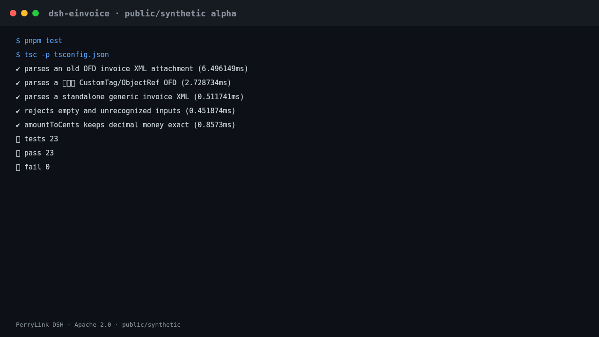

<div align="center">

# dsh-einvoice

> **官方仓库。** 本包唯一官方仓库，由 PerryLink 维护；其他账号下的同名仓库与本项目无关。Apache-2.0。

[](https://www.npmjs.com/package/dsh-einvoice)
[](https://github.com/PerryLink/dsh-einvoice/actions)
[](LICENSE)
[](https://github.com/topics/dsh-plugin)
[](https://perrylink.github.io/dsh-plugins/)
[](https://gitee.com/perrylink/dsh-plugins)
[](https://dshfind.com/plugins/PerryLink/dsh-einvoice?ref=badge)
[](https://dsh.market/)
[](#)
[](https://www.npmjs.com/package/dsh-einvoice)

**文件级中国电子发票（OFD/XML）入库、解析、去重与本地归档。**

> **状态：alpha / 公开合成 / partial / not counted / 非 GA。** 不含客户证据、客户数据，也不作生产可用声明。

[English](README.md) · [简体中文](README-zh.md) · [Español](README-es.md) · [Português](README-pt.md) · [हिन्दी](README-hi.md)

```sh
dsh plugin --profile <profile> add dsh-einvoice
```

</div>

> ⭐ 如果它帮到了你，点个 star 会让下一个人更容易找到它；没有任何功能被 star 解锁。


*工作流：本地输入 → 插件 → 本地输出；不需要调用模型。*



*本地真实测试运行；不调用模型或网络。*

## 快速了解（3 分钟）

**一句话**：把本地 OFD/XML 电子发票解析成八个字段并查重，全程留在本机。

**适合**：报销前几十到几百张电子发票的自查；同一张发票被两个主体重复提交的排查；把票据按期间归集。
**不适合**：需要税局验真、抵扣勾选的场景（本包**不联网**、不调税局接口）；扫描件/图片发票（不做 OCR）；PDF 发票。

**输入**：本地 `.ofd`（数电票 `Tags/CustomTag.xml` 或旧版 `Attachs/original_invoice.xml`）或 `.xml` 电子发票；UTF-8；单文件 ≤50 MB；来自开票方下载或财务系统导出。
自带样例：`samples/quickstart/input/invoice-a.xml` 与 `invoice-a-copy.ofd`（合成：发票号自造、税号 `91330106TESTBUYER0` / `91310115TESTSELLER` 明显为假值）。

**输出**：发票号、开票日期、购销方、金额/税额/价税合计（整数分）、明细行、字段证据与未知字段；重复分组与查询结果。原件与索引写在 `$DSH_HOME/storages/dsh-einvoice`，**不改原文件**。

**示例**：把这句话直接发给助手：

> 我把同一张电子发票分别报给了两家主体（invoice-a.xml 和 invoice-a-copy.ofd），帮我入库解析后查重，告诉我发票号和价税合计。

预期输出（真实运行结果）：`samples/quickstart/expected/result.json`。同一份样例的真实运行截图：


**权限**：

```text
读：用户指定的 .ofd/.xml 电子发票文件；不读其他目录
写：$DSH_HOME/storages/dsh-einvoice（原件、索引与归档）；不改原文件
联网：否
外部系统：无（不调税局/发票查验平台，不做验真）
```

以上与源码一致：`apply()` 只从 `DSH_EINVOICE_HOME`（缺省 `$DSH_HOME/storages/dsh-einvoice`）取写入目录，源码里没有 `fetch`/`http.request` 等网络调用。会写盘的工具（`invoice.ingest`、`invoice.review_queue`、`invoice.record_receipt`、`invoice.redlink`、`invoice.archive`、`invoice.restore`）标 **R1 本地写**，只读工具（`invoice.parse`、`invoice.query`、`invoice.dedup`、`invoice.check`、`invoice.tax_id_check`、`invoice.code_check`）标 **R0**。

### FAQ

1. **装不上怎么办？** 先看 `node --version` 是否 ≥24.9、`dsh --version` 是否在 `>=0.2.1-rc.3 <0.4.0`；再跑 `dsh plugin --profile <profile> add dsh-einvoice`。
2. **结果不对怎么办？** 先看 `field_evidence`（每个字段来自哪个部件/节点）与 `unknown_fields`；解析前必须 `invoice.ingest`。本包不做验真，金额勾稽只校验 `价税合计 = 金额 + 税额`。
3. **能处理我的发票吗？** 能处理标准 OFD/XML 电子发票；全程本机运行、不联网、不上传。PDF、扫描件、图片发票不支持。
4. **同一张发票为什么解析两次会报 `E_INV_DUP_CONFLICT`？** 同一主体下发票号唯一；这是防重复入池的保护。要保留两边记录，请用不同 `entity_id`（自带样例就是这样演示跨主体查重的）。

**版本**：0.2.0-alpha.11（alpha，`counted=false`，非 GA）。测试：`node --test test/*.test.mjs` 通过 32 项、跳过 6 项（公开样本缺失，属正常）、失败 0；验收见 `ACCEPTANCE.csv`。

## 安装

安装并验证：

```sh
dsh plugin --profile <profile> add dsh-einvoice
dsh --profile <profile> --dump-config | grep dsh-einvoice
```

卸载：

```sh
dsh plugin --profile <profile> remove dsh-einvoice
```


### 安装通道

推荐 npm；其他通道用于固定版本或离线。

- **npm（推荐）:** `dsh plugin --profile <profile> add dsh-einvoice`
- **git 通道:** `dsh plugin --profile <profile> add github:PerryLink/dsh-einvoice`
- **tarball:** `pnpm pack` then `dsh plugin --profile <profile> add ./dsh-einvoice-<version>.tgz`
- **1024 商店:** `npm i -g dsh1024` then `dsh1024 plugin --profile <profile> add dsh-einvoice`

## 它做什么

文件级中国电子发票（OFD/XML）入库、解析、去重与本地归档。 在 DeepSeek Harness 本地运行；下表就是实际工具面，示例使用真实命令面。

输入和输出都留在本地，不上传。

## 工具

工具名是稳定 API；说明已本地化。

| 工具 | 用途 | 风险 |
|---|---|---|
| `invoice.ingest` | 导入单个本地 OFD/XML，计算 SHA-256，保存原始文件，并以字节为准保证幂等 | R1 本地写 |
| `invoice.parse` | 解析旧版 OFD 的 `Attachs/original_invoice.xml` 或数电票的 `Tags/CustomTag.xml`；返回八个字段、明细行、证据及未知字段 | R0 只读 |
| `invoice.query` | 按主体、期间、生命周期或文本查询本地票据池 | R0 只读 |
| `invoice.dedup` | 按发票号码或销售方 + 日期 + 总额对重复项分组 | R0 只读 |
| `invoice.review_queue` | 将已解析发票排入本地人工复核队列；可选标记购买方税号不一致 | R1 本地写 |
| `invoice.record_receipt` | 对本地回执计算哈希，追加该回执并推进生命周期；`verification_source=local_receipt`，`tax_verified=false` | R1 本地写 |
| `invoice.redlink` | 将负数红字发票与其蓝字发票绑定并保存差额 | R1 本地写 |
| `invoice.archive` | 在本地归档目录下生成清单 + 原始文件 + 回执的 ZIP | R1 本地写 |
| `invoice.check` | 校验清单与成员哈希、缺失文件及路径穿越 | R0 只读 |
| `invoice.restore` | 将已校验的归档恢复到本地恢复根目录 | R1 本地写 |
| `invoice.tax_id_check` | 校验 18 位统一社会信用代码（GB 32100-2015 mod-31 校验位） | R0 只读 |
| `invoice.code_check` | 检查币种/国家/税类代码表（EN 16931） | R0 只读 |

## 快速开始

```sh
dsh plugin --profile <profile> add dsh-einvoice
dsh --profile <profile> --dump-config | grep dsh-einvoice
```

装上后，把上面「示例」里那句话发给助手即可。在仓库里也可以直接跑同一套工具：

```sh
pnpm build && node samples/quickstart/run.mjs
```

它会用 `samples/quickstart/input/invoice-a.xml` 与 `invoice-a-copy.ofd` 依次调用 `invoice.ingest → invoice.parse → invoice.dedup → invoice.query`，并打印结果。

## 示例

### fixture 支撑的示例

输入: [`fixtures/public/mit/invoice-github-sample.xml`](https://github.com/PerryLink/dsh-einvoice/blob/main/fixtures/public/mit/invoice-github-sample.xml)

命令: `pnpm test`

验收行:

| req_id | metric | threshold | actual | pass | source | counted |
|---|---|---|---|---|---|---|
| SKU-04-A01 | 八字段完整率（S1 合成样本） | >=0.98 | 1 | true | public/synthetic | false |

*这是 fixture 支撑的验收行，不是客户运行；没有编造输出。*

## 边界

- 仅公开/合成样例；不含客户数据或客户证据。
- alpha/partial、not counted，不作 GA 或生产可用声明。
- 除非工具明确说明，否则不调用模型、不联网。
- 每个工具的精确边界见工具表与 `ACCEPTANCE.csv`。

## 公开样例

公开/合成 fixture 在 `fixtures/`；`ACCEPTANCE.csv` 记录公开检查，全部 `counted=false`。

## 开发

```sh
pnpm install --frozen-lockfile
pnpm build && pnpm lint && pnpm typecheck && pnpm test
```

## 兼容性

| 维度 | 状态 |
|---|---|
| Harness | `dsh >=0.2.1-rc.3 <0.3.0` |
| Node | `>=24.9.0 <25` |
| Platforms | All; local files only |
| 数据 | No network, no model call, no upload |

## 权限与数据

- 本地运行；不联网、不调用模型、不上传。
- 只使用公开/合成 fixture；不含客户数据或客户证据。
- alpha/partial；not counted，不作 GA 或生产可用声明。

## 相关项目

兄弟包与家族索引： [dsh-bankrec](https://github.com/PerryLink/dsh-bankrec) · [dsh-ap-three-way](https://github.com/PerryLink/dsh-ap-three-way) · [dsh-travel-recon](https://github.com/PerryLink/dsh-travel-recon) · [dsh-finops-suite](https://github.com/PerryLink/dsh-finops-suite)

相关核查器（英文表）: [Related checkers](README.md#related-checkers).

- [故障排查（英文）](TROUBLESHOOTING.md)
- [领域索引](https://perrylink.github.io/dsh-plugins/)
- [Checker 家族](https://perrylink.github.io/zh/checkers/)
- [主线家族](https://github.com/PerryLink/dsh-kit)
- [Scenario article](https://perrylink.github.io/dsh-plugins/articles/finops-suite.html)

## 家族

<details>
<summary>DSH 领域插件家族（15 个包 + 2 个 suite）</summary>

| Package | npm |
|---|---|
| **[dsh-einvoice](https://github.com/PerryLink/dsh-einvoice)** | [npm](https://www.npmjs.com/package/dsh-einvoice) |
| **[dsh-docx-redline](https://github.com/PerryLink/dsh-docx-redline)** | [npm](https://www.npmjs.com/package/dsh-docx-redline) |
| **[dsh-policy-ledger](https://github.com/PerryLink/dsh-policy-ledger)** | [npm](https://www.npmjs.com/package/dsh-policy-ledger) |
| **[dsh-ghg](https://github.com/PerryLink/dsh-ghg)** | [npm](https://www.npmjs.com/package/dsh-ghg) |
| **[dsh-bankrec](https://github.com/PerryLink/dsh-bankrec)** | [npm](https://www.npmjs.com/package/dsh-bankrec) |
| **[dsh-ap-three-way](https://github.com/PerryLink/dsh-ap-three-way)** | [npm](https://www.npmjs.com/package/dsh-ap-three-way) |
| **[dsh-ifc-qto](https://github.com/PerryLink/dsh-ifc-qto)** | [npm](https://www.npmjs.com/package/dsh-ifc-qto) |
| **[dsh-qms-capa](https://github.com/PerryLink/dsh-qms-capa)** | [npm](https://www.npmjs.com/package/dsh-qms-capa) |
| **[dsh-legal-intake](https://github.com/PerryLink/dsh-legal-intake)** | [npm](https://www.npmjs.com/package/dsh-legal-intake) |
| **[dsh-legal-clause](https://github.com/PerryLink/dsh-legal-clause)** | [npm](https://www.npmjs.com/package/dsh-legal-clause) |
| **[dsh-freight-audit](https://github.com/PerryLink/dsh-freight-audit)** | [npm](https://www.npmjs.com/package/dsh-freight-audit) |
| **[dsh-hs-candidate](https://github.com/PerryLink/dsh-hs-candidate)** | [npm](https://www.npmjs.com/package/dsh-hs-candidate) |
| **[dsh-travel-recon](https://github.com/PerryLink/dsh-travel-recon)** | [npm](https://www.npmjs.com/package/dsh-travel-recon) |
| **[dsh-pim-lint](https://github.com/PerryLink/dsh-pim-lint)** | [npm](https://www.npmjs.com/package/dsh-pim-lint) |
| **[dsh-eval-pack](https://github.com/PerryLink/dsh-eval-pack)** | [npm](https://www.npmjs.com/package/dsh-eval-pack) |
| **[dsh-finops-suite](https://github.com/PerryLink/dsh-finops-suite)** | [npm](https://www.npmjs.com/package/dsh-finops-suite) |
| **[dsh-contract-suite](https://github.com/PerryLink/dsh-contract-suite)** | [npm](https://www.npmjs.com/package/dsh-contract-suite) |

</details>


<details>
<summary>主线家族 — 92 个当前安装 spec</summary>

| Package | npm |
|---|---|
| **[dsh-aqua-input-check](https://github.com/PerryLink/dsh-aqua-input-check)** | [npm](https://www.npmjs.com/package/dsh-aqua-input-check) |
| **[dsh-archive-check](https://github.com/PerryLink/dsh-archive-check)** | [npm](https://www.npmjs.com/package/dsh-archive-check) |
| **[dsh-bid-ca-precheck](https://github.com/PerryLink/dsh-bid-ca-precheck)** | [npm](https://www.npmjs.com/package/dsh-bid-ca-precheck) |
| **[dsh-bid-qual-check](https://github.com/PerryLink/dsh-bid-qual-check)** | [npm](https://www.npmjs.com/package/dsh-bid-qual-check) |
| **[dsh-contract-stance](https://github.com/PerryLink/dsh-contract-stance)** | [npm](https://www.npmjs.com/package/dsh-contract-stance) |
| **[dsh-customs-doc-check](https://github.com/PerryLink/dsh-customs-doc-check)** | [npm](https://www.npmjs.com/package/dsh-customs-doc-check) |
| **[dsh-demurrage-ledger](https://github.com/PerryLink/dsh-demurrage-ledger)** | [npm](https://www.npmjs.com/package/dsh-demurrage-ledger) |
| **[dsh-drill-script-check](https://github.com/PerryLink/dsh-drill-script-check)** | [npm](https://www.npmjs.com/package/dsh-drill-script-check) |
| **[dsh-eia-guide-check](https://github.com/PerryLink/dsh-eia-guide-check)** | [npm](https://www.npmjs.com/package/dsh-eia-guide-check) |
| **[dsh-emergency-plan](https://github.com/PerryLink/dsh-emergency-plan)** | [npm](https://www.npmjs.com/package/dsh-emergency-plan) |
| **[dsh-essay-rubric-check](https://github.com/PerryLink/dsh-essay-rubric-check)** | [npm](https://www.npmjs.com/package/dsh-essay-rubric-check) |
| **[dsh-evidence-check](https://github.com/PerryLink/dsh-evidence-check)** | [npm](https://www.npmjs.com/package/dsh-evidence-check) |
| **[dsh-export-ctl-check](https://github.com/PerryLink/dsh-export-ctl-check)** | [npm](https://www.npmjs.com/package/dsh-export-ctl-check) |
| **[dsh-fmea-table-check](https://github.com/PerryLink/dsh-fmea-table-check)** | [npm](https://www.npmjs.com/package/dsh-fmea-table-check) |
| **[dsh-forecast-penalty](https://github.com/PerryLink/dsh-forecast-penalty)** | [npm](https://www.npmjs.com/package/dsh-forecast-penalty) |
| **[dsh-gongwen-flow-check](https://github.com/PerryLink/dsh-gongwen-flow-check)** | [npm](https://www.npmjs.com/package/dsh-gongwen-flow-check) |
| **[dsh-gongwen-word-check](https://github.com/PerryLink/dsh-gongwen-word-check)** | [npm](https://www.npmjs.com/package/dsh-gongwen-word-check) |
| **[dsh-guard-plan-qc](https://github.com/PerryLink/dsh-guard-plan-qc)** | [npm](https://www.npmjs.com/package/dsh-guard-plan-qc) |
| **[dsh-hazchem-check](https://github.com/PerryLink/dsh-hazchem-check)** | [npm](https://www.npmjs.com/package/dsh-hazchem-check) |
| **[dsh-hazplan-check](https://github.com/PerryLink/dsh-hazplan-check)** | [npm](https://www.npmjs.com/package/dsh-hazplan-check) |
| **[dsh-hidden-risk-map](https://github.com/PerryLink/dsh-hidden-risk-map)** | [npm](https://www.npmjs.com/package/dsh-hidden-risk-map) |
| **[dsh-hs-classify](https://github.com/PerryLink/dsh-hs-classify)** | [npm](https://www.npmjs.com/package/dsh-hs-classify) |
| **[dsh-icd-rule-check](https://github.com/PerryLink/dsh-icd-rule-check)** | [npm](https://www.npmjs.com/package/dsh-icd-rule-check) |
| **[dsh-lawcite-adapter](https://github.com/PerryLink/dsh-lawcite-adapter)** | [npm](https://www.npmjs.com/package/dsh-lawcite-adapter) |
| **[dsh-lc-doc-check](https://github.com/PerryLink/dsh-lc-doc-check)** | [npm](https://www.npmjs.com/package/dsh-lc-doc-check) |
| **[dsh-learning-gap-check](https://github.com/PerryLink/dsh-learning-gap-check)** | [npm](https://www.npmjs.com/package/dsh-learning-gap-check) |
| **[dsh-medrec-qc](https://github.com/PerryLink/dsh-medrec-qc)** | [npm](https://www.npmjs.com/package/dsh-medrec-qc) |
| **[dsh-nsfc-form-check](https://github.com/PerryLink/dsh-nsfc-form-check)** | [npm](https://www.npmjs.com/package/dsh-nsfc-form-check) |
| **[dsh-nurse-record-check](https://github.com/PerryLink/dsh-nurse-record-check)** | [npm](https://www.npmjs.com/package/dsh-nurse-record-check) |
| **[dsh-origin-rvc-check](https://github.com/PerryLink/dsh-origin-rvc-check)** | [npm](https://www.npmjs.com/package/dsh-origin-rvc-check) |
| **[dsh-ota-review-check](https://github.com/PerryLink/dsh-ota-review-check)** | [npm](https://www.npmjs.com/package/dsh-ota-review-check) |
| **[dsh-paper-doc-adapter](https://github.com/PerryLink/dsh-paper-doc-adapter)** | [npm](https://www.npmjs.com/package/dsh-paper-doc-adapter) |
| **[dsh-permit-report-check](https://github.com/PerryLink/dsh-permit-report-check)** | [npm](https://www.npmjs.com/package/dsh-permit-report-check) |
| **[dsh-pipeline-check](https://github.com/PerryLink/dsh-pipeline-check)** | [npm](https://www.npmjs.com/package/dsh-pipeline-check) |
| **[dsh-pleading-draft](https://github.com/PerryLink/dsh-pleading-draft)** | [npm](https://www.npmjs.com/package/dsh-pleading-draft) |
| **[dsh-policy-brief-draft](https://github.com/PerryLink/dsh-policy-brief-draft)** | [npm](https://www.npmjs.com/package/dsh-policy-brief-draft) |
| **[dsh-power-loss-split](https://github.com/PerryLink/dsh-power-loss-split)** | [npm](https://www.npmjs.com/package/dsh-power-loss-split) |
| **[dsh-power-ticket-check](https://github.com/PerryLink/dsh-power-ticket-check)** | [npm](https://www.npmjs.com/package/dsh-power-ticket-check) |
| **[dsh-ppap-check](https://github.com/PerryLink/dsh-ppap-check)** | [npm](https://www.npmjs.com/package/dsh-ppap-check) |
| **[dsh-protest-deadline](https://github.com/PerryLink/dsh-protest-deadline)** | [npm](https://www.npmjs.com/package/dsh-protest-deadline) |
| **[dsh-railway-window](https://github.com/PerryLink/dsh-railway-window)** | [npm](https://www.npmjs.com/package/dsh-railway-window) |
| **[dsh-repair-order-qc](https://github.com/PerryLink/dsh-repair-order-qc)** | [npm](https://www.npmjs.com/package/dsh-repair-order-qc) |
| **[dsh-review-reply-check](https://github.com/PerryLink/dsh-review-reply-check)** | [npm](https://www.npmjs.com/package/dsh-review-reply-check) |
| **[dsh-rulefile-check](https://github.com/PerryLink/dsh-rulefile-check)** | [npm](https://www.npmjs.com/package/dsh-rulefile-check) |
| **[dsh-safety-brief-check](https://github.com/PerryLink/dsh-safety-brief-check)** | [npm](https://www.npmjs.com/package/dsh-safety-brief-check) |
| **[dsh-site-log-check](https://github.com/PerryLink/dsh-site-log-check)** | [npm](https://www.npmjs.com/package/dsh-site-log-check) |
| **[dsh-soe-decision-check](https://github.com/PerryLink/dsh-soe-decision-check)** | [npm](https://www.npmjs.com/package/dsh-soe-decision-check) |
| **[dsh-soilwater-check](https://github.com/PerryLink/dsh-soilwater-check)** | [npm](https://www.npmjs.com/package/dsh-soilwater-check) |
| **[dsh-sop-sync-check](https://github.com/PerryLink/dsh-sop-sync-check)** | [npm](https://www.npmjs.com/package/dsh-sop-sync-check) |
| **[dsh-spc-gbt-adapter](https://github.com/PerryLink/dsh-spc-gbt-adapter)** | [npm](https://www.npmjs.com/package/dsh-spc-gbt-adapter) |
| **[dsh-tender-extract](https://github.com/PerryLink/dsh-tender-extract)** | [npm](https://www.npmjs.com/package/dsh-tender-extract) |
| **[dsh-tender-matrix](https://github.com/PerryLink/dsh-tender-matrix)** | [npm](https://www.npmjs.com/package/dsh-tender-matrix) |
| **[dsh-warranty-calc](https://github.com/PerryLink/dsh-warranty-calc)** | [npm](https://www.npmjs.com/package/dsh-warranty-calc) |
| **[dsh-auto-review](https://github.com/PerryLink/dsh-auto-review)** | [npm](https://www.npmjs.com/package/dsh-auto-review) |
| **[dsh-autotier](https://github.com/PerryLink/dsh-autotier)** | [npm](https://www.npmjs.com/package/dsh-autotier) |
| **[dsh-budget](https://github.com/PerryLink/dsh-budget)** | [npm](https://www.npmjs.com/package/dsh-budget) |
| **[dsh-cert-mcp](https://github.com/PerryLink/dsh-cert-mcp)** | [npm](https://www.npmjs.com/package/dsh-cert-mcp) |
| **[dsh-checkpoint-rewind](https://github.com/PerryLink/dsh-checkpoint-rewind)** | [npm](https://www.npmjs.com/package/dsh-checkpoint-rewind) |
| **[dsh-claude-move](https://github.com/PerryLink/dsh-claude-move)** | [npm](https://www.npmjs.com/package/dsh-claude-move) |
| **[dsh-click](https://github.com/PerryLink/dsh-click)** | [npm](https://www.npmjs.com/package/dsh-click) |
| **[dsh-composer-history](https://github.com/PerryLink/dsh-composer-history)** | [npm](https://www.npmjs.com/package/dsh-composer-history) |
| **[dsh-data-quality](https://github.com/PerryLink/dsh-data-quality)** | [npm](https://www.npmjs.com/package/dsh-data-quality) |
| **[dsh-defend](https://github.com/PerryLink/dsh-defend)** | [npm](https://www.npmjs.com/package/dsh-defend) |
| **[dsh-doublecheck](https://github.com/PerryLink/dsh-doublecheck)** | [npm](https://www.npmjs.com/package/dsh-doublecheck) |
| **[dsh-draw](https://github.com/PerryLink/dsh-draw)** | [npm](https://www.npmjs.com/package/dsh-draw) |
| **[dsh-fast](https://github.com/PerryLink/dsh-fast)** | [npm](https://www.npmjs.com/package/dsh-fast) |
| **[dsh-fund-research](https://github.com/PerryLink/dsh-fund-research)** | [npm](https://www.npmjs.com/package/dsh-fund-research) |
| **[dsh-industry-research](https://github.com/PerryLink/dsh-industry-research)** | [npm](https://www.npmjs.com/package/dsh-industry-research) |
| **[dsh-laya](https://github.com/PerryLink/dsh-laya)** | [npm](https://www.npmjs.com/package/dsh-laya) |
| **[dsh-library](https://github.com/PerryLink/dsh-library)** | [npm](https://www.npmjs.com/package/dsh-library) |
| **[dsh-local-ai](https://github.com/PerryLink/dsh-local-ai)** | [npm](https://www.npmjs.com/package/dsh-local-ai) |
| **[dsh-lsp-actions](https://github.com/PerryLink/dsh-lsp-actions)** | [npm](https://www.npmjs.com/package/dsh-lsp-actions) |
| **[dsh-mask](https://github.com/PerryLink/dsh-mask)** | [npm](https://www.npmjs.com/package/dsh-mask) |
| **[dsh-mcp-panel](https://github.com/PerryLink/dsh-mcp-panel)** | [npm](https://www.npmjs.com/package/dsh-mcp-panel) |
| **[dsh-memento](https://github.com/PerryLink/dsh-memento)** | [npm](https://www.npmjs.com/package/dsh-memento) |
| **[dsh-observe](https://github.com/PerryLink/dsh-observe)** | [npm](https://www.npmjs.com/package/dsh-observe) |
| **[dsh-output-styles](https://github.com/PerryLink/dsh-output-styles)** | [npm](https://www.npmjs.com/package/dsh-output-styles) |
| **[dsh-permission-rules](https://github.com/PerryLink/dsh-permission-rules)** | [npm](https://www.npmjs.com/package/dsh-permission-rules) |
| **[dsh-plugin-guide](https://github.com/PerryLink/dsh-plugin-guide)** | [npm](https://www.npmjs.com/package/dsh-plugin-guide) |
| **[dsh-plugin-upgrade](https://github.com/PerryLink/dsh-plugin-upgrade)** | [npm](https://www.npmjs.com/package/dsh-plugin-upgrade) |
| **[dsh-reach](https://github.com/PerryLink/dsh-reach)** | [npm](https://www.npmjs.com/package/dsh-reach) |
| **[dsh-research-report](https://github.com/PerryLink/dsh-research-report)** | [npm](https://www.npmjs.com/package/dsh-research-report) |
| **[dsh-score](https://github.com/PerryLink/dsh-score)** | [npm](https://www.npmjs.com/package/dsh-score) |
| **[dsh-session-sync](https://github.com/PerryLink/dsh-session-sync)** | [npm](https://www.npmjs.com/package/dsh-session-sync) |
| **[dsh-talk](https://github.com/PerryLink/dsh-talk)** | [npm](https://www.npmjs.com/package/dsh-talk) |
| **[dsh-test-drive](https://github.com/PerryLink/dsh-test-drive)** | [npm](https://www.npmjs.com/package/dsh-test-drive) |
| **[dsh-translate](https://github.com/PerryLink/dsh-translate)** | [npm](https://www.npmjs.com/package/dsh-translate) |
| **[](https://github.com/PerryLink/)** | [npm](https://www.npmjs.com/package/) |
| **[](https://github.com/PerryLink/)** | [npm](https://www.npmjs.com/package/) |
| **[](https://github.com/PerryLink/)** | [npm](https://www.npmjs.com/package/) |
| **[](https://github.com/PerryLink/)** | [npm](https://www.npmjs.com/package/) |
| **[](https://github.com/PerryLink/)** | [npm](https://www.npmjs.com/package/) |

</details>

## 许可证

Apache-2.0. See `LICENSE`, `NOTICE`, `THIRD-PARTY-NOTICES`.
