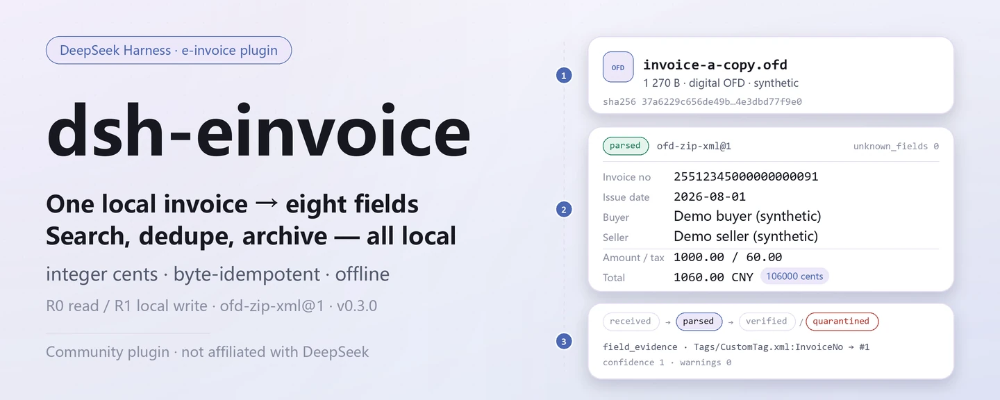

<div align="center">

<picture>
  <source media="(prefers-color-scheme: dark)" srcset="docs/assets/dsh-einvoice-hero-en-dark.webp">
  
</picture>

# dsh-einvoice

**Turn local e-invoices into a searchable, deduplicated, archivable ledger — originals untouched, fully offline.**

A file-level Chinese e-invoice (OFD/XML) plugin for DeepSeek Harness: ingest, parse, deduplicate, record receipts, link red/blue invoices, archive and verify — all on your machine; no tax-bureau call, no model call.

[Install](#three-step-setup) · [Configuration](#configuration) · [FAQ](#faq) · [简体中文](README.md) · [English](README.en.md) · [Español](README.es.md) · [Português](README.pt.md) · [हिन्दी](README.hi.md)

[](LICENSE)
[](#compatibility)
[](https://www.npmjs.com/package/dsh-einvoice)
[](https://github.com/PerryLink/dsh-einvoice/actions/workflows/ci.yml)
[](#compatibility)

[](https://github.com/PerryLink/dsh-einvoice/stargazers)
[](https://www.npmjs.com/package/dsh-einvoice)
[](https://dshfind.com/plugins/PerryLink/dsh-einvoice?ref=badge)
[](https://dsh.market/)
[](https://gitee.com/perrylink/dsh-einvoice)

```sh
dsh plugin --profile <profile> add dsh-einvoice
```

</div>

<sub>Community plugin, not affiliated with DeepSeek. Canonical repository: <https://github.com/PerryLink/dsh-einvoice> (Gitee is a mirror). Status: alpha · verified on public/synthetic data only · not GA — no customer data or customer evidence, no production-readiness claim.</sub>

## What it is

Read one local `.ofd` / `.xml` e-invoice, compute its SHA-256, keep the original, and parse the eight fields (invoice number, issue date, buyer and seller, amount, tax, total), line items, field evidence and unknown fields; then aggregate everything into a local pool you can query, deduplicate and archive by entity and period. Money is reconciled in integer cents, re-ingesting the same bytes is idempotent, and an invoice number is unique within one entity. Everything runs on your machine — no network, no model call, no upload, and the original file is never modified.

- **Good fit**: self-checks before reimbursing tens to a few hundred e-invoices; finding the same invoice submitted by two different entities; collecting invoices by period, recording receipts, linking red/blue invoices, and keeping a verifiable archive package.
- **Not a fit**: tax-bureau verification or input-VAT deduction (this package is **offline** and calls no tax-bureau API); scanned or photographed invoices (no OCR); PDF invoices.

<picture>
  <source media="(prefers-color-scheme: dark)" srcset="docs/assets/dsh-einvoice-flow-v5-dark.svg">
  
</picture>

## Three-step setup

1. **Install** (pick one channel):

   ```sh
   # npm channel (recommended; published releases)
   dsh plugin --profile <profile> add dsh-einvoice
   # git channel (latest main; equivalent to git+https://github.com/PerryLink/dsh-einvoice.git)
   dsh plugin --profile <profile> add github:PerryLink/dsh-einvoice
   # tarball channel: pnpm pack in this repo, then
   dsh plugin --profile <profile> add ./dsh-einvoice-<version>.tgz
   ```

2. **Minimal config**: there are no plugin-level config keys — `cordis.patch.yml` only `insert`s one row, and the defaults work. Only environment variables may need adjusting (see "Configuration").

   ```yaml
   - insert:
       - id: dsh-einvoice
         name: dsh-einvoice
   ```

3. **Verify it mounts**:

   ```sh
   dsh --profile <profile> --dump-config | grep dsh-einvoice
   node samples/quickstart/run.mjs
   ```

   The quickstart uses the two synthetic invoices shipped with the package (one XML, one digital e-invoice OFD) and calls `invoice_ingest → invoice_parse → invoice_dedup → invoice_query` in order. It should end with:

   ```text
   ok: quickstart finished (6 tool calls, 1 duplicate invoice found)
   ```

   Inside a session you can also just ask — this is a translation of the demo prompt shipped in `package.json` as `dsh.demo.prompt`:

   > I submitted the same e-invoice under two entities (invoice-a.xml and invoice-a-copy.ofd). Ingest and parse both, deduplicate them, and tell me the invoice number and the total.

**Uninstall**: `dsh plugin --profile <profile> remove dsh-einvoice` (or remove the row from the profile patch).

<details>
<summary>Install from the DSH Desktop market</summary>

Every PerryLink plugin is listed in the built-in DSH Desktop market: **Market → Sources → Add source → paste** `https://perrylink-dsh-catalog.perrylink.workers.dev/catalog-source.json` **→ select**. Installation still requires the market's npm identity check and your confirmation.

</details>

## Core capabilities

- **File-level ingest** — `invoice_ingest` reads one local OFD/XML under the allowed input roots, computes its SHA-256 and stores the original under `originals/` with mode `0600`; re-ingesting the same bytes returns the existing `doc_id` instead of creating a new record.
- **Eight-field parsing** — `invoice_parse` runs the `ofd-zip-xml@1` adapter over old OFD (`Attachs/original_invoice.xml`), digital e-invoice OFD (`Tags/CustomTag.xml` + `ObjectRef`) and standalone XML; it returns the eight fields, line items, `field_evidence` (which node each field came from) and `unknown_fields`.
- **Local pool query** — `invoice_query` filters by entity, period, lifecycle or text with stable paging; each row carries `doc_id`, invoice number, parties, amounts and parser version.
- **Duplicate detection** — `invoice_dedup` groups by invoice number, falling back to seller tax id + issue date + total when the number is absent; read-only, it neither merges nor rewrites records.
- **Manual review queue** — `invoice_review_queue` queues parsed invoices for local review, optionally flags `entity_mismatch` / `missing_buyer_tax_id` against an expected buyer tax id; it never contacts a tax bureau.
- **Local receipts** — `invoice_record_receipt` hashes a local receipt file, appends an immutable receipt and advances the lifecycle; it returns `verification_source=local_receipt`, `tax_verified=false`, and is explicitly not tax-bureau verification.
- **Red/blue linking** — `invoice_redlink` binds a negative red invoice to its blue invoice, storing the allocation and the amount / tax deltas; binding it to a different blue invoice raises `E_INV_REDLINK_BOUND` instead of silently rebinding.
- **Archive, check and restore** — `invoice_archive` builds a deterministic ZIP with `manifest.json`, originals and receipts; `invoice_check` verifies manifest hashes, member hashes, missing files and directory traversal; `invoice_restore` writes only after `invoice_check` semantics pass.
- **Tax-id and code-list checks** — `invoice_tax_id_check` validates the 18-character Unified Social Credit Code (GB 32100-2015 mod-31 check character); `invoice_code_check` checks currency / country / VAT category codes (EN 16931); both are read-only.
- **Purely local** — no `fetch` / HTTP / DNS / WebSocket calls in the source; no tax bureau, invoice-verification platform, ERP or cloud connection.

### Tool surface

Tool names are a stable API (matched to runtime output, kept in English); descriptions are localized. Writing tools are marked **R1 (local write)**, read-only tools **R0**.

| Tool | Purpose | Risk |
|---|---|---|
| `invoice_ingest` | Ingest one local OFD/XML: path allowlist, ≤50 MB, SHA-256, original retention, idempotent by bytes | R1 local write |
| `invoice_parse` | Parse old OFD `Attachs/original_invoice.xml` or digital e-invoice `Tags/CustomTag.xml`; return eight fields, lines, field evidence and unknown fields | R0 read-only |
| `invoice_query` | Query the local pool by entity, period, lifecycle or text with stable paging (1–200 per page) | R0 read-only |
| `invoice_dedup` | Group duplicates by invoice number, or seller + date + total | R0 read-only |
| `invoice_review_queue` | Queue parsed invoices for manual local review; optional buyer-tax-id mismatch flags | R1 local write |
| `invoice_record_receipt` | Hash a local receipt, append it and advance the lifecycle; `verification_source=local_receipt`, `tax_verified=false` | R1 local write |
| `invoice_redlink` | Bind a negative red invoice to its blue invoice and store allocation and deltas | R1 local write |
| `invoice_archive` | Build a deterministic manifest + originals + receipts ZIP under the local archive directory, then self-check it | R1 local write |
| `invoice_check` | Verify manifest/member hashes, missing files and directory traversal; read-only | R0 read-only |
| `invoice_restore` | Restore a verified archive into the local restore root; refuse one that fails verification | R1 local write |
| `invoice_tax_id_check` | Validate the 18-character Unified Social Credit Code (GB 32100-2015 mod-31) | R0 read-only |
| `invoice_code_check` | Check currency / country / VAT category code lists (EN 16931) | R0 read-only |

`invoice_verify` and `invoice_receipt` remain as deprecated aliases of `invoice_review_queue` / `invoice_record_receipt`; new code should use the new names.

### Input and output

Input:

- A local `.ofd` (digital e-invoice `Tags/CustomTag.xml`, or old `Attachs/original_invoice.xml`) or `.xml` e-invoice; UTF-8; at most 50 MB per file; downloaded from the issuer or exported from a finance system.
- The input roots come from `DSH_EINVOICE_INPUT_ROOTS` (default: the cwd of the host process); paths are resolved with `realpath`, and symlink escapes are rejected.
- Shipped samples: `samples/quickstart/input/invoice-a.xml` and `invoice-a-copy.ofd` (synthetic: invented invoice number, obviously fake tax ids `91330106TESTBUYER0` / `91310115TESTSELLER`).

Output:

- Invoice number, issue date, buyer and seller, amount / tax / total in integer cents, line items, field evidence and unknown fields; duplicate groups and query results.
- Originals and the index live under `$DSH_HOME/storages/dsh-einvoice` (override with `DSH_EINVOICE_HOME`); the **original file is never modified**; archives and restores land in `archives/` and `restore/`.
- Every error carries an `E_INV_…` code, a plain-language message and one next action, so you can act on it directly.

### Examples

Paste this line (translated from the demo prompt shipped in `package.json` as `dsh.demo.prompt`):

```text
I submitted the same e-invoice under two entities (invoice-a.xml and invoice-a-copy.ofd). Ingest and parse both, deduplicate them, and tell me the invoice number and the total.
```

Or run it yourself (a real run — the screenshot comes from this command):

```sh
node samples/quickstart/run.mjs
```


*Synthetic samples → gold file `samples/quickstart/expected/result.json`; the command and output hashes are recorded in `screenshots.json` (real run on 2026-11-02).*

## Measured data

The public/synthetic acceptance suite is reproduced with `scripts/acceptance.mjs`; details live in `ACCEPTANCE.csv`. These are its 10 rows, quoted verbatim (the full file also carries `script` and `evidence_sha256`):

```csv
req_id,metric,threshold,actual,pass,source,counted
SKU-04-A01,八字段完整率（S1 合成样本）,>=0.98,1,true,public/synthetic,false
SKU-04-A02,扫描/OCR（未实现）,out_of_scope,out_of_scope,false,public/synthetic,false
SKU-04-A06,单票解析 P95（S1）,<20s,0.0027510999999999512,true,public/synthetic,false
SKU-04-A07,负样本处理率 + 字段证据覆盖（S1）,100%,1,true,public/synthetic,false
SKU-04-A08,统一社会信用代码校验位（GB 32100-2015）,1/1,1,true,public/synthetic,false
SKU-04-A09,EN 16931 代码表（币种/国家/税类）,0 issues,0,true,public/synthetic,false
SKU-04-A05,回执完整率（S2 单票）,100%,1,true,public/synthetic,false
SKU-04-A03,红蓝勾稽（S3 单对）,100%,1,true,public/synthetic,false
SKU-04-A04,归档复原（S3 单包）,100%,1,true,public/synthetic,false
PS1-QS01,quickstart 样例与金标一致,1/1,1,true,synthetic/quickstart,true
```

`SKU-04-A02` has `pass=false` because scanning / OCR is explicitly out of scope and unimplemented — not a regression. The other SKU rows are public/synthetic fixture checks (`counted=false`); only `PS1-QS01` is a local reproduction of the shipped sample (`counted=true`). Single-invoice parse P95 measured ≈ `0.00275 s` (threshold `<20 s`). None of this is a customer run, and no output is invented.

## Configuration

This plugin has no Schemastery config keys: `cordis.patch.yml` only `insert`s one row (`id: dsh-einvoice`), and the defaults work. What you can tune is two environment variables and the tool arguments.

| Variable | Default | Meaning |
|---|---|---|
| `DSH_EINVOICE_HOME` | `$DSH_HOME/storages/dsh-einvoice` | Base directory for originals (`originals/`), archives (`archives/`), restores (`restore/`) and the local pool; without `DSH_HOME` it falls back to `storages/dsh-einvoice` under the host process cwd |
| `DSH_EINVOICE_INPUT_ROOTS` | cwd of the host process | Allowed input roots for `invoice_ingest` / `invoice_record_receipt`, separated by `path.delimiter` (`;` on Windows) |

The most-used tool arguments:

| Parameter | Default | Applies to | Meaning |
|---|---|---|---|
| `entity_id` | `default` (`ingest` only) | `invoice_ingest` / `query` / `review_queue` / `archive` | Legal-entity id; an invoice number is unique within one entity |
| `page` | `50` | `invoice_query` | Page size, 1–200 |
| `profile` | `ofd-zip-xml` | `invoice_parse` | Parser profile; the package ships only `ofd-zip-xml` |
| `ocr` | `off` | `invoice_parse` | The package runs no OCR and accepts only `off` |
| `limit` | `100` | `invoice_review_queue` | Maximum queue entries for this call, 1–200 |
| `include_receipts` | `true` | `invoice_archive` | Whether receipts are packed into the archive |

<details>
<summary>Error codes and troubleshooting</summary>

The full error-code table (20 codes, with retryability and user action) is in [`docs/configuration.md`](docs/configuration.md); symptom / cause / action steps are in [`TROUBLESHOOTING.md`](TROUBLESHOOTING.md). The most common ones:

| Code | When it appears | Next step |
|---|---|---|
| `E_INV_FILE_UNREADABLE` | Path missing, 0 bytes, or over 50 MB | Check the path is under an input root, or start with the shipped sample |
| `E_INV_PATH_NOT_ALLOWED` | File is outside `DSH_EINVOICE_INPUT_ROOTS` | Move the file under an input root, or widen the variable |
| `E_INV_DOC_NOT_FOUND` | `doc_id` was never ingested | Run `invoice_ingest` first |
| `E_INV_DUP_CONFLICT` | Invoice number already exists under the same `entity_id` | Use `invoice_query`, or pick a different `entity_id` |
| `E_INV_OFD_UNSUPPORTED` | ZIP is not an OFD, or no recognized invoice XML inside | Use the issuer's original `.ofd`; PDF / images are unsupported |
| `E_INV_XML_SCHEMA_DRIFT` | Total ≠ amount + tax, or the structure drifted | Use `field_evidence` to locate the node; confirm the invoice was not re-edited |

</details>

## FAQ

<details>
<summary>Where does the data live? Are my original files touched?</summary>

Originals are stored by content hash under `$DSH_HOME/storages/dsh-einvoice/originals/` (mode `0600`), the index lives in the local `fin_invoice` storage domain, archive packages go to `archives/`, and restores go to `restore/`. Input files are read-only — the tools never rewrite them and there is no upload path.

</details>

<details>
<summary>Can it process my real invoices? Does it verify them with the tax bureau?</summary>

It parses standard OFD/XML e-invoices locally, but the package is alpha and verified only on public/synthetic data — it is not an audit, reimbursement or payment conclusion. Sanitize real data before use and keep a human reviewer. **No tax-bureau verification**: `invoice_record_receipt` only records a local receipt (`verification_source=local_receipt`, `tax_verified=false`) and never connects to the tax bureau or an invoice-verification platform.

</details>

<details>
<summary>Why does parsing the same invoice twice raise `E_INV_DUP_CONFLICT`?</summary>

An invoice number is unique within one `entity_id`; this protects the pool from duplicate ingestion and is not a parse failure. Use `invoice_query` to inspect the existing record; if the same invoice really was submitted by two entities, parse it under a different `entity_id` — that is exactly what the shipped sample demonstrates.

</details>

<details>
<summary>The parsed fields look wrong — what now?</summary>

Start with `field_evidence` (which XML node or `ObjectRef` each field came from) and `unknown_fields` (present in the invoice but unused by this package); the money check only asserts total = amount + tax. `invoice_ingest` must run before `invoice_parse`; structural drift raises `E_INV_XML_SCHEMA_DRIFT` instead of silently guessing.

</details>

<details>
<summary>It will not install / mount — what now?</summary>

Check `node --version` for `>=24.9 <25` and `dsh --version` for `>=0.2.1-rc.3 <0.4.0`, then confirm the mount with `dsh --profile <profile> --dump-config | grep dsh-einvoice`. Full steps are in [`TROUBLESHOOTING.md`](TROUBLESHOOTING.md).

</details>

## Security boundaries

- **No network, no model call.** The source contains no `fetch` / HTTP / DNS / WebSocket calls; the demo metadata in `package.json` also declares `network: false`. Input and output stay local.
- **Original files are never modified.** Writes land only under `$DSH_EINVOICE_HOME` (default `$DSH_HOME/storages/dsh-einvoice`) in `originals/`, `archives/`, `restore/` and the local storage domain; originals are written with mode `0600`.
- **Input path allowlist.** Paths are resolved with `realpath` and must stay under `DSH_EINVOICE_INPUT_ROOTS`; symlink escapes, empty files, non-regular files and files over 50 MB are rejected.
- **Bounded OFD unzip.** At most 1000 entries and 100 MB uncompressed; XML entity processing is disabled, blocking zip bombs and entity expansion.
- **Archive tamper and traversal guards.** `invoice_check` verifies manifest hashes, member hashes, missing files and directory traversal; `pkg_id` must match `^pkg_[0-9a-f]{16}$`, the restore target must stay under the restore root, and `invoice_restore` refuses a package that fails verification.
- **Duplicate protection.** Re-ingesting the same bytes is idempotent by `source_sha256`; an invoice number is unique within one `entity_id`; rebinding a red invoice to a different blue invoice is rejected (`E_INV_REDLINK_BOUND`).
- **Uniform errors, loud failures.** Failures carry an `E_INV_…` code with a plain message and one next step; unsupported input fails loudly instead of degrading silently.
- **No hidden surface.** No R2/R3 tools, no MCP exposure, no client half; the host mounts only the `tools` and `storageDomain` services.

## Permissions & data

- **Reads**: the `.ofd` / `.xml` e-invoices and receipt files you point at (must be under an input root); no other directories.
- **Writes**: `$DSH_HOME/storages/dsh-einvoice` (originals, index, archives, restores); original files untouched.
- **Network**: no (no HTTP / DNS / WebSocket calls in the source).
- **External systems**: none (no tax bureau, invoice-verification platform or ERP; no uploads).
- **Data boundary**: verified on public/synthetic samples only; no customer data, no customer evidence.

## Known limitations

- **Verified on public/synthetic data only.** Every acceptance row comes from a public or synthetic fixture (`counted=false` for the SKU rows in `ACCEPTANCE.csv`; PS1-QS01 is a local sample reproduction with `counted=true`); no customer data or customer evidence.
- **Alpha / partial / not counted / not GA.** No production-readiness claim; not an audit, reimbursement or payment conclusion.
- **No OCR.** Scanned, photographed and PDF invoices are unsupported; `invoice_parse` accepts only `ocr: off`.
- **No tax-bureau verification.** A receipt is a local record only (`tax_verified=false`); use official channels for input-VAT deduction or tax-bureau checks.
- **Single-file ingest.** One OFD/XML per call, at most 50 MB; loop `invoice_ingest` for batches.
- **CNY and one parser only.** Currency is fixed to `CNY` and amounts are integer cents; the only parser is `ofd-zip-xml` (version `ofd-zip-xml@1`), and an unknown profile raises `E_INV_UNKNOWN_IMPL`.
- **Storage is JSON KV.** The `fin_invoice` domain has no foreign keys, cross-table transactions or migrations; `(entity_id, invoice_no)` uniqueness is checked in application code.
- **No client UI.** The package is host-only and registers no slot or client package; everything goes through the tool surface.
- **Exact boundaries.** Per-tool boundaries are exactly the "Core capabilities" tool table plus `ACCEPTANCE.csv`.

## Interoperability with other DSH plugins

- **Namespaced tool names.** Every tool lives under `invoice_*` and does not take a bare name used by built-in tools or another plugin.
- **No host surface stealing.** It registers no command, client slot, `webServer` route or service key; it only injects the `tools` and `storageDomain` host services.
- **Independent storage domain.** It uses one domain, `fin_invoice` (version 1); teardown is a Cordis effect, so stopping or hot-reloading the plugin undoes it.
- **Complementary responsibilities.** Ledger-level checks belong to [`dsh-invoice-ledger`](https://github.com/PerryLink/dsh-invoice-ledger), and two-table reconciliation to [`dsh-excel-reconcile`](https://github.com/PerryLink/dsh-excel-reconcile); each is a separate package, installed only when needed.

## Compatibility

| Surface | Status |
|---|---|
| Harness | DeepSeek Harness `>=0.2.1-rc.3 <0.4.0` (`engines.dsh` in `package.json`) |
| Node | `>=24.9.0 <25` (`.nvmrc`: 24) |
| Platforms | Anywhere DSH runs; local files only |
| Data | No network, no model call, no upload |

## Ecosystem & quality

- [Gitee mirror](https://gitee.com/perrylink/dsh-einvoice) (sync mirror; GitHub is canonical)
- [dshfind plugin page](https://dshfind.com/plugins/PerryLink/dsh-einvoice) (installs and ranking)
- [DSH Market](https://dsh.market/) (listed)
- **1024 store channel**: `npm i -g dsh1024` once, then `dsh1024 plugin --profile <profile> add dsh-einvoice` (counts toward the [deepseek1024.com](https://deepseek1024.com) install ranking)
- Docs: [`TROUBLESHOOTING.md`](TROUBLESHOOTING.md) · [`PRIVACY.md`](PRIVACY.md) · [`SECURITY.md`](SECURITY.md) · [`docs/architecture.md`](docs/architecture.md) · [`docs/configuration.md`](docs/configuration.md)
- Indexes: [Domain index](https://perrylink.github.io/dsh-plugins/) · [Checker family](https://perrylink.github.io/zh/checkers/) · [Scenario article](https://perrylink.github.io/dsh-plugins/articles/finops-suite.html)

### Related work and checkers

Sibling packages and family indexes: [dsh-bankrec](https://github.com/PerryLink/dsh-bankrec) · [dsh-ap-three-way](https://github.com/PerryLink/dsh-ap-three-way) · [dsh-travel-recon](https://github.com/PerryLink/dsh-travel-recon) · [dsh-finops-suite](https://github.com/PerryLink/dsh-finops-suite)

Each checker is a separate package with its own rule pack and version; install only the ones you need:

| Package | Why it is relevant |
|---|---|
| [`dsh-invoice-ledger`](https://github.com/PerryLink/dsh-invoice-ledger) | Invoice-ledger-level duplicate, arithmetic, party and date checks; complements this package's file-level parsing |
| [`dsh-excel-reconcile`](https://github.com/PerryLink/dsh-excel-reconcile) | General two-table reconciliation when the invoice pool must be aligned with an external ledger |

## Development

```sh
pnpm install --frozen-lockfile
pnpm build && pnpm lint && pnpm typecheck && pnpm test   # tsc build + node --test test/*.test.mjs (11 test files)
pnpm gate:sku04                                         # acceptance gate (ACCEPTANCE.csv)
node scripts/acceptance.mjs                             # re-run public/synthetic acceptance
node samples/quickstart/run.mjs                         # synthetic sample; expect 6 tool calls and 1 duplicate group
```

TypeScript sources live in `src/` (`src/core/` for the eight fields and money, `src/adapters/` for OFD/XML parsing, `src/registry/` for the parser registry, `src/plugin/` for the host face); build output goes to `lib/`; fixtures are in `fixtures/`, and the shipped sample in `samples/quickstart/`. Current version `0.3.0` (matches `package.json`). Tests run with `node --test test/*.test.mjs`; skips caused by missing public samples are normal, not failures (see [`TROUBLESHOOTING.md`](TROUBLESHOOTING.md)). The banner and the structure diagram are generated programmatically by [`scripts/gen-readme-assets.py`](scripts/gen-readme-assets.py) (Python: four 1440×576 webp banners via Pillow, plus a hand-written 1100×660 SVG pair for the structure diagram) and are safe to re-run.

Topics: `deepseek-harness`, `dsh`, `dsh-plugin`, `einvoice`, `invoice`, `ofd`, `perrylink`, `finance`

## Family & thanks

This project is part of the DeepSeek Harness plugin family from [PerryLink](https://github.com/PerryLink) (all Apache-2.0). If it is useful, **a star helps the next person find it** — nothing is gated behind it.

- [@PerryLink](https://github.com/PerryLink) — creator and maintainer: the OFD/XML parser, eight-field normalization, the invoice pool and dedup, receipts / red-blue linking / archive verification, the quickstart and acceptance suite, and the five-language docs.

## License

[LICENSE](LICENSE) (Apache License 2.0) © 2026 dsh-einvoice contributors; see also `NOTICE` and `THIRD-PARTY-NOTICES`.

<p align="center"><sub>Apache-2.0 · Community plugin, not affiliated with DeepSeek.</sub></p>
