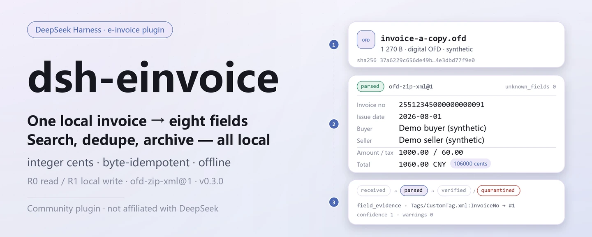
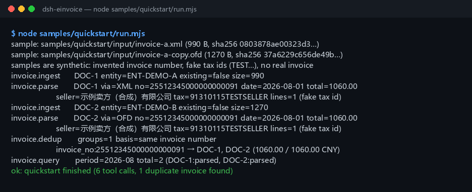

<div align="center">

<picture>
  <source media="(prefers-color-scheme: dark)" srcset="docs/assets/dsh-einvoice-hero-en-dark.webp">
  
</picture>

# dsh-einvoice

**Convierte las facturas electrónicas locales en un registro consultable, deduplicado y archivable — originales intactos y todo sin conexión.**

Un plugin de facturación electrónica china (OFD/XML) a nivel de archivo para DeepSeek Harness: ingesta, análisis, deduplicación, recibos, enlace rojo/azul, archivo y verificación, todo en tu máquina; sin llamadas a la autoridad fiscal ni al modelo.

[Instalar](#instalación-en-tres-pasos) · [Configuración](#configuración) · [FAQ](#faq) · [简体中文](README.md) · [English](README.en.md) · [Español](README.es.md) · [Português](README.pt.md) · [हिन्दी](README.hi.md)

[](LICENSE)
[](#compatibilidad)
[](https://www.npmjs.com/package/dsh-einvoice)
[](https://github.com/PerryLink/dsh-einvoice/actions/workflows/ci.yml)
[](#compatibilidad)

[](https://github.com/PerryLink/dsh-einvoice/stargazers)
[](https://www.npmjs.com/package/dsh-einvoice)
[](https://dshfind.com/plugins/PerryLink/dsh-einvoice?ref=badge)
[](https://dsh.market/)
[](https://gitee.com/perrylink/dsh-einvoice)

```sh
dsh plugin --profile <profile> add dsh-einvoice
```

</div>

<sub>Plugin de la comunidad, no afiliado a DeepSeek. Repositorio canónico: <https://github.com/PerryLink/dsh-einvoice> (Gitee es un espejo). Estado: alpha · verificado solo con datos públicos/sintéticos · no GA — sin datos ni evidencia de clientes, sin promesa de producción.</sub>

## Qué es

Lee una factura electrónica local `.ofd` / `.xml`, calcula su SHA-256, conserva el original y extrae los ocho campos (número de factura, fecha de emisión, comprador y vendedor, importe, impuesto y total), las líneas, la evidencia de campos y los campos desconocidos; después lo agrega todo en un registro local que puedes consultar, deduplicar y archivar por entidad y periodo. El dinero se concilia en céntimos enteros, reingresar los mismos bytes es idempotente y el número de factura es único dentro de una entidad. Todo se ejecuta en tu máquina — sin red, sin llamadas al modelo, sin subidas, y el archivo original nunca se modifica.

- **Adecuado para**: autocomprobaciones antes de reembolsar decenas o unos cientos de facturas electrónicas; detectar la misma factura presentada por dos entidades; agrupar facturas por periodo, registrar recibos, enlazar facturas rojas/azules y conservar un paquete de archivo verificable.
- **No adecuado para**: verificación ante la autoridad fiscal o deducción de IVA soportado (este paquete es **offline** y no llama a ninguna API fiscal); facturas escaneadas o fotografiadas (sin OCR); facturas PDF.

<picture>
  <source media="(prefers-color-scheme: dark)" srcset="docs/assets/dsh-einvoice-flow-v5-dark.svg">
  
</picture>

## Instalación en tres pasos

1. **Instalar** (elige un canal):

   ```sh
   # canal npm (recomendado; versiones publicadas)
   dsh plugin --profile <profile> add dsh-einvoice
   # canal git (último main; equivalente a git+https://github.com/PerryLink/dsh-einvoice.git)
   dsh plugin --profile <profile> add github:PerryLink/dsh-einvoice
   # canal tarball: pnpm pack en este repo, luego
   dsh plugin --profile <profile> add ./dsh-einvoice-<version>.tgz
   ```

2. **Configuración mínima**: no hay claves de configuración propias del plugin — `cordis.patch.yml` solo `insert` una fila y los valores predeterminados funcionan. Solo podrían necesitar ajuste las variables de entorno (ver «Configuración»).

   ```yaml
   - insert:
       - id: dsh-einvoice
         name: dsh-einvoice
   ```

3. **Verificar que se monta**:

   ```sh
   dsh --profile <profile> --dump-config | grep dsh-einvoice
   node samples/quickstart/run.mjs
   ```

   El quickstart usa las dos facturas sintéticas incluidas (una XML y una OFD de factura digital) y llama en orden a `invoice.ingest → invoice.parse → invoice.dedup → invoice.query`. Debe terminar con:

   ```text
   ok: quickstart finished (6 tool calls, 1 duplicate invoice found)
   ```

   Dentro de una sesión también basta con pedirlo — es una traducción del prompt de demostración incluido en `package.json` como `dsh.demo.prompt`:

   > Presenté la misma factura electrónica bajo dos entidades (invoice-a.xml y invoice-a-copy.ofd). Ingiere y analiza ambas, deduplica y dime el número de factura y el total.

**Desinstalar**: `dsh plugin --profile <profile> remove dsh-einvoice` (o quita la fila del patch del perfil).

<details>
<summary>Instalar desde el mercado de DSH Desktop</summary>

Todos los plugins de PerryLink están en el mercado integrado de DSH Desktop: **Market → Sources → Add source → pega** `https://perrylink-dsh-catalog.perrylink.workers.dev/catalog-source.json` **→ selecciona**. La instalación sigue requiriendo la verificación de identidad npm del mercado y tu confirmación.

</details>

## Capacidades clave

- **Ingesta a nivel de archivo** — `invoice.ingest` lee un OFD/XML local dentro de las raíces de entrada permitidas, calcula su SHA-256 y guarda el original en `originals/` con modo `0600`; reingresar los mismos bytes devuelve el `doc_id` existente en lugar de crear otro registro.
- **Análisis de ocho campos** — `invoice.parse` ejecuta el adaptador `ofd-zip-xml@1` sobre OFD antiguo (`Attachs/original_invoice.xml`), OFD de factura digital (`Tags/CustomTag.xml` + `ObjectRef`) y XML independiente; devuelve los ocho campos, las líneas, `field_evidence` (de qué nodo viene cada campo) y `unknown_fields`.
- **Consulta del registro local** — `invoice.query` filtra por entidad, periodo, ciclo de vida o texto con paginación estable; cada fila lleva `doc_id`, número de factura, partes, importes y versión del analizador.
- **Detección de duplicados** — `invoice.dedup` agrupa por número de factura y, si falta, por NIF del vendedor + fecha de emisión + total; es de solo lectura, no fusiona ni reescribe registros.
- **Cola de revisión manual** — `invoice.review_queue` encola facturas analizadas para revisión local y puede marcar `entity_mismatch` / `missing_buyer_tax_id` contra un NIF de comprador esperado; nunca contacta a la autoridad fiscal.
- **Recibos locales** — `invoice.record_receipt` calcula el hash de un recibo local, añade un recibo inmutable y avanza el ciclo de vida; devuelve `verification_source=local_receipt`, `tax_verified=false` y no es verificación fiscal.
- **Enlace rojo/azul** — `invoice.redlink` vincula una factura roja negativa con su factura azul, guardando la asignación y los deltas de importe / impuesto; vincularla a otra factura azul lanza `E_INV_REDLINK_BOUND` en lugar de revincular en silencio.
- **Archivo, comprobación y restauración** — `invoice.archive` construye un ZIP determinista con `manifest.json`, originales y recibos; `invoice.check` verifica hashes del manifiesto, hashes de miembros, archivos faltantes y path traversal; `invoice.restore` escribe solo cuando se supera la verificación.
- **Comprobaciones de NIF y listas de códigos** — `invoice.tax_id_check` valida el Código Unificado de Crédito Social de 18 caracteres (GB 32100-2015, dígito de control mod-31); `invoice.code_check` comprueba códigos de moneda / país / categoría de IVA (EN 16931); ambas son de solo lectura.
- **Puramente local** — sin llamadas `fetch` / HTTP / DNS / WebSocket en el código; sin conexión a la autoridad fiscal, a plataformas de verificación de facturas, a ERP ni a la nube.

### Superficie de herramientas

Los nombres de las herramientas son una API estable (coinciden con la salida del runtime y se mantienen en inglés); las descripciones están localizadas. Las herramientas que escriben se marcan **R1 (escritura local)** y las de solo lectura **R0**.

| Herramienta | Propósito | Riesgo |
|---|---|---|
| `invoice.ingest` | Ingestar un OFD/XML local: lista blanca de rutas, ≤50 MB, SHA-256, conservar el original, idempotente por bytes | R1 escritura local |
| `invoice.parse` | Analizar OFD antiguo `Attachs/original_invoice.xml` o factura digital `Tags/CustomTag.xml`; devolver ocho campos, líneas, evidencia y campos desconocidos | R0 solo lectura |
| `invoice.query` | Consultar el registro local por entidad, periodo, ciclo de vida o texto con paginación estable (1–200 por página) | R0 solo lectura |
| `invoice.dedup` | Agrupar duplicados por número de factura, o vendedor + fecha + total | R0 solo lectura |
| `invoice.review_queue` | Encolar facturas analizadas para revisión manual local; marcas opcionales de NIF de comprador inconsistente | R1 escritura local |
| `invoice.record_receipt` | Calcular hash de un recibo local, añadirlo y avanzar el ciclo de vida; `verification_source=local_receipt`, `tax_verified=false` | R1 escritura local |
| `invoice.redlink` | Vincular una factura roja negativa con su factura azul y guardar asignación y deltas | R1 escritura local |
| `invoice.archive` | Construir un ZIP determinista con manifiesto + originales + recibos en el directorio local de archivo y autocomprobarlo | R1 escritura local |
| `invoice.check` | Verificar hashes de manifiesto/miembros, archivos faltantes y path traversal; solo lectura | R0 solo lectura |
| `invoice.restore` | Restaurar un archivo verificado en la raíz local de restauración; rechaza el que no pase la verificación | R1 escritura local |
| `invoice.tax_id_check` | Validar el Código Unificado de Crédito Social de 18 caracteres (GB 32100-2015 mod-31) | R0 solo lectura |
| `invoice.code_check` | Comprobar las listas de códigos de moneda / país / categoría de IVA (EN 16931) | R0 solo lectura |

`invoice.verify` e `invoice.receipt` se mantienen como alias obsoletos de `invoice.review_queue` / `invoice.record_receipt`; el código nuevo debe usar los nombres nuevos.

### Entrada y salida

Entrada:

- Una factura electrónica local `.ofd` (factura digital `Tags/CustomTag.xml`, o antigua `Attachs/original_invoice.xml`) o `.xml`; UTF-8; como máximo 50 MB por archivo; descargada del emisor o exportada de un sistema financiero.
- Las raíces de entrada vienen de `DSH_EINVOICE_INPUT_ROOTS` (predeterminado: el cwd del proceso anfitrión); las rutas se resuelven con `realpath` y los escapes por enlace simbólico se rechazan.
- Muestras incluidas: `samples/quickstart/input/invoice-a.xml` e `invoice-a-copy.ofd` (sintéticas: número de factura inventado y NIF obviamente falsos `91330106TESTBUYER0` / `91310115TESTSELLER`).

Salida:

- Número de factura, fecha de emisión, comprador y vendedor, importe / impuesto / total en céntimos enteros, líneas, evidencia de campos y campos desconocidos; grupos de duplicados y resultados de consulta.
- Originales e índice bajo `$DSH_HOME/storages/dsh-einvoice` (se puede sobrescribir con `DSH_EINVOICE_HOME`); el **archivo original nunca se modifica**; los archivos y las restauraciones caen en `archives/` y `restore/`.
- Cada error trae un código `E_INV_…`, un mensaje llano y una acción siguiente, para que puedas actuar directamente.

### Ejemplos

Pega esta línea (traducida del prompt de demostración incluido en `package.json` como `dsh.demo.prompt`):

```text
Presenté la misma factura electrónica bajo dos entidades (invoice-a.xml y invoice-a-copy.ofd). Ingiere y analiza ambas, deduplica y dime el número de factura y el total.
```

O ejecútalo tú mismo (ejecución real — la captura viene de este comando):

```sh
node samples/quickstart/run.mjs
```



*Muestras sintéticas → archivo de oro `samples/quickstart/expected/result.json`; el comando y los hashes de salida están en `screenshots.json` (ejecución real del 2026-11-02).*

## Datos medidos

La aceptación pública/sintética se reproduce con `scripts/acceptance.mjs`; el detalle está en `ACCEPTANCE.csv`. Estas son sus 10 filas, citadas literalmente (el archivo completo también incluye `script` y `evidence_sha256`):

```csv
req_id,metric,threshold,actual,pass,source,counted
SKU-04-A01,八字段完整率（S1 合成样本）,>=0.98,1,true,public/synthetic,false
SKU-04-A02,扫描/OCR（未实现）,out_of_scope,out_of_scope,false,public/synthetic,false
SKU-04-A06,单票解析 P95（S1）,<20s,0.0027510999999999512,true,public/synthetic,false
SKU-04-A07,负样本处理率 + 字段证据覆盖（S1）,100%,1,true,public/synthetic,false
SKU-04-A08,统一社会信用代码校验位（GB 32100-2015）,1/1,1,true,public/synthetic,false
SKU-04-A09,EN 16931 代码表（币种/国家/税类）,0 issues,0,true,public/synthetic,false
SKU-04-A05,回执完整率（S2 单票）,100%,1,true,public/synthetic,false
SKU-04-A03,红蓝勾稽（S3 单对）,100%,1,true,public/synthetic,false
SKU-04-A04,归档复原（S3 单包）,100%,1,true,public/synthetic,false
PS1-QS01,quickstart 样例与金标一致,1/1,1,true,synthetic/quickstart,true
```

`SKU-04-A02` tiene `pass=false` porque el escaneo / OCR está explícitamente fuera de alcance y sin implementar — no es una regresión. Las demás filas SKU son comprobaciones de fixture pública/sintética (`counted=false`); solo `PS1-QS01` es una reproducción local de la muestra incluida (`counted=true`). El P95 de análisis de una factura medido es ≈ `0.00275 s` (umbral `<20 s`). Nada de esto es una ejecución de cliente y no se inventa salida.

## Configuración

Este plugin no tiene claves `Config` de Schemastery: `cordis.patch.yml` solo `insert` una fila (`id: dsh-einvoice`) y los valores predeterminados funcionan. Lo ajustable son dos variables de entorno y los argumentos de las herramientas.

| Variable | Predeterminado | Significado |
|---|---|---|
| `DSH_EINVOICE_HOME` | `$DSH_HOME/storages/dsh-einvoice` | Directorio base de originales (`originals/`), archivos (`archives/`), restauraciones (`restore/`) y del registro local; sin `DSH_HOME` cae en `storages/dsh-einvoice` bajo el cwd del proceso anfitrión |
| `DSH_EINVOICE_INPUT_ROOTS` | cwd del proceso anfitrión | Raíces de entrada permitidas para `invoice.ingest` / `invoice.record_receipt`, separadas por `path.delimiter` (`;` en Windows) |

Los argumentos de herramienta más usados:

| Parámetro | Predeterminado | Se aplica a | Significado |
|---|---|---|---|
| `entity_id` | `default` (solo `ingest`) | `invoice.ingest` / `query` / `review_queue` / `archive` | Id de la entidad legal; el número de factura es único dentro de una entidad |
| `page` | `50` | `invoice.query` | Tamaño de página, 1–200 |
| `profile` | `ofd-zip-xml` | `invoice.parse` | Perfil del analizador; el paquete solo incluye `ofd-zip-xml` |
| `ocr` | `off` | `invoice.parse` | El paquete no ejecuta OCR y solo acepta `off` |
| `limit` | `100` | `invoice.review_queue` | Máximo de entradas en cola para esta llamada, 1–200 |
| `include_receipts` | `true` | `invoice.archive` | Si los recibos se empaquetan en el archivo |

<details>
<summary>Códigos de error y resolución de problemas</summary>

La tabla completa de códigos de error (20 códigos, con reintentabilidad y acción del usuario) está en [`docs/configuration.md`](docs/configuration.md); los pasos síntoma / causa / acción están en [`TROUBLESHOOTING.md`](TROUBLESHOOTING.md). Los más comunes:

| Código | Cuándo aparece | Siguiente paso |
|---|---|---|
| `E_INV_FILE_UNREADABLE` | Ruta inexistente, 0 bytes o más de 50 MB | Comprueba que la ruta esté bajo una raíz de entrada, o empieza con la muestra incluida |
| `E_INV_PATH_NOT_ALLOWED` | El archivo está fuera de `DSH_EINVOICE_INPUT_ROOTS` | Mueve el archivo a una raíz de entrada o amplía la variable |
| `E_INV_DOC_NOT_FOUND` | El `doc_id` nunca se ingirió | Ejecuta `invoice.ingest` primero |
| `E_INV_DUP_CONFLICT` | El número de factura ya existe bajo el mismo `entity_id` | Usa `invoice.query`, o elige otro `entity_id` |
| `E_INV_OFD_UNSUPPORTED` | El ZIP no es un OFD o no hay XML de factura reconocible | Usa el `.ofd` original del emisor; PDF / imágenes no son compatibles |
| `E_INV_XML_SCHEMA_DRIFT` | Total ≠ importe + impuesto, o la estructura cambió | Usa `field_evidence` para localizar el nodo; confirma que la factura no fue reeditada |

</details>

## FAQ

<details>
<summary>¿Dónde viven los datos? ¿Se tocan mis archivos originales?</summary>

Los originales se guardan por hash de contenido en `$DSH_HOME/storages/dsh-einvoice/originals/` (modo `0600`), el índice vive en el dominio de almacenamiento local `fin_invoice`, los paquetes de archivo van a `archives/` y las restauraciones a `restore/`. Los archivos de entrada son de solo lectura — las herramientas nunca los reescriben y no hay ruta de subida.

</details>

<details>
<summary>¿Puede procesar mis facturas reales? ¿Las verifica con la autoridad fiscal?</summary>

Analiza facturas electrónicas OFD/XML estándar en local, pero el paquete es alpha y solo está verificado con datos públicos/sintéticos — no constituye una conclusión de auditoría, reembolso ni pago. Anonimiza los datos reales antes de usarlos y mantén un revisor humano. **Sin verificación fiscal**: `invoice.record_receipt` solo registra un recibo local (`verification_source=local_receipt`, `tax_verified=false`) y nunca se conecta a la autoridad fiscal ni a una plataforma de verificación de facturas.

</details>

<details>
<summary>¿Por qué analizar dos veces la misma factura lanza `E_INV_DUP_CONFLICT`?</summary>

El número de factura es único dentro de un `entity_id`; esto protege el registro frente a ingestas duplicadas y no es un fallo de análisis. Usa `invoice.query` para inspeccionar el registro existente; si la misma factura realmente fue presentada por dos entidades, analízala con otro `entity_id` — es exactamente lo que demuestra la muestra incluida.

</details>

<details>
<summary>Los campos analizados no cuadran — ¿qué hago?</summary>

Empieza por `field_evidence` (de qué nodo XML o `ObjectRef` viene cada campo) y `unknown_fields` (presentes en la factura pero no usados por este paquete); la comprobación monetaria solo exige total = importe + impuesto. `invoice.ingest` debe ejecutarse antes de `invoice.parse`; una deriva estructural lanza `E_INV_XML_SCHEMA_DRIFT` en lugar de adivinar en silencio.

</details>

<details>
<summary>No se instala / no se monta — ¿qué hago?</summary>

Comprueba `node --version` para `>=24.9 <25` y `dsh --version` para `>=0.2.1-rc.3 <0.4.0`; luego confirma el montaje con `dsh --profile <profile> --dump-config | grep dsh-einvoice`. Los pasos completos están en [`TROUBLESHOOTING.md`](TROUBLESHOOTING.md).

</details>

## Límites de seguridad

- **Sin red, sin llamadas a un modelo.** El código no contiene llamadas `fetch` / HTTP / DNS / WebSocket; los metadatos de demostración de `package.json` también declaran `network: false`. La entrada y la salida permanecen locales.
- **Los archivos originales nunca se modifican.** Las escrituras caen solo bajo `$DSH_EINVOICE_HOME` (predeterminado `$DSH_HOME/storages/dsh-einvoice`) en `originals/`, `archives/`, `restore/` y el dominio de almacenamiento local; los originales se escriben con modo `0600`.
- **Lista blanca de rutas de entrada.** Las rutas se resuelven con `realpath` y deben quedar bajo `DSH_EINVOICE_INPUT_ROOTS`; se rechazan escapes por enlace simbólico, archivos vacíos, no regulares y mayores de 50 MB.
- **Descompresión OFD acotada.** Como máximo 1000 entradas y 100 MB descomprimidos; el procesamiento de entidades XML está desactivado, bloqueando bombas ZIP y expansión de entidades.
- **Guardias de manipulación y path traversal en el archivo.** `invoice.check` verifica hashes del manifiesto, hashes de miembros, archivos faltantes y path traversal; `pkg_id` debe coincidir con `^pkg_[0-9a-f]{16}$`, el destino de restauración debe quedar bajo la raíz de restauración y `invoice.restore` rechaza un paquete que no supere la verificación.
- **Protección contra duplicados.** Reingresar los mismos bytes es idempotente por `source_sha256`; el número de factura es único dentro de un `entity_id`; revincular una factura roja a otra factura azul se rechaza (`E_INV_REDLINK_BOUND`).
- **Errores uniformes, fallos en voz alta.** Los fallos traen un código `E_INV_…`, un mensaje llano y un siguiente paso; una entrada no soportada falla en voz alta en lugar de degradarse en silencio.
- **Sin superficie oculta.** Sin herramientas R2/R3, sin exposición MCP, sin mitad cliente; el anfitrión solo monta los servicios `tools` y `storageDomain`.

## Permisos y datos

- **Lee**: las facturas electrónicas `.ofd` / `.xml` y los archivos de recibo que indiques (deben estar bajo una raíz de entrada); ningún otro directorio.
- **Escribe**: `$DSH_HOME/storages/dsh-einvoice` (originales, índice, archivos, restauraciones); los originales intactos.
- **Red**: no (sin llamadas HTTP / DNS / WebSocket en el código).
- **Sistemas externos**: ninguno (sin autoridad fiscal, plataforma de verificación de facturas ni ERP; sin subidas).
- **Frontera de datos**: verificado solo con muestras públicas/sintéticas; sin datos ni evidencia de clientes.

## Limitaciones conocidas

- **Verificado solo con datos públicos/sintéticos.** Cada fila de aceptación proviene de una fixture pública o sintética (filas SKU con `counted=false` en `ACCEPTANCE.csv`; PS1-QS01 es una reproducción local de la muestra con `counted=true`); sin datos ni evidencia de clientes.
- **Alpha / parcial / no contabilizado / no GA.** Sin promesa de producción; no constituye conclusión de auditoría, reembolso ni pago.
- **Sin OCR.** Facturas escaneadas, fotografiadas y PDF no son compatibles; `invoice.parse` solo acepta `ocr: off`.
- **Sin verificación fiscal.** Un recibo es solo un registro local (`tax_verified=false`); para deducción de IVA soportado o comprobaciones fiscales usa los canales oficiales.
- **Ingesta de un solo archivo.** Un OFD/XML por llamada, como máximo 50 MB; para lotes, itera `invoice.ingest`.
- **Solo CNY y un analizador.** La moneda está fijada a `CNY` y los importes van en céntimos enteros; el único analizador es `ofd-zip-xml` (versión `ofd-zip-xml@1`), y un perfil desconocido lanza `E_INV_UNKNOWN_IMPL`.
- **El almacenamiento es JSON KV.** El dominio `fin_invoice` no tiene claves externas, transacciones entre tablas ni migraciones; la unicidad de `(entity_id, invoice_no)` se comprueba en el código de aplicación.
- **Sin interfaz de cliente.** El paquete es solo host y no registra slot ni paquete cliente; todo pasa por la superficie de herramientas.
- **Límites exactos.** Los límites por herramienta son exactamente la tabla de «Capacidades clave» más `ACCEPTANCE.csv`.

## Interoperabilidad con otros plugins DSH

- **Nombres de herramienta con espacio de nombres.** Todas las herramientas viven bajo `invoice.*` y no ocupan un nombre desnudo de las herramientas integradas ni de otro plugin.
- **No roba superficie del anfitrión.** No registra comandos, slots de cliente, rutas `webServer` ni claves de servicio; solo inyecta los servicios de anfitrión `tools` y `storageDomain`.
- **Dominio de almacenamiento independiente.** Usa un único dominio, `fin_invoice` (versión 1); el desmontaje es un effect de Cordis, así que detener o recargar en caliente lo deshace.
- **Responsabilidades complementarias.** Las comprobaciones a nivel de libro mayor corresponden a [`dsh-invoice-ledger`](https://github.com/PerryLink/dsh-invoice-ledger), y la conciliación de dos tablas a [`dsh-excel-reconcile`](https://github.com/PerryLink/dsh-excel-reconcile); cada uno es un paquete independiente, que se instala solo si hace falta.

## Compatibilidad

| Superficie | Estado |
|---|---|
| Harness | DeepSeek Harness `>=0.2.1-rc.3 <0.4.0` (`engines.dsh` en `package.json`) |
| Node | `>=24.9.0 <25` (`.nvmrc`: 24) |
| Plataformas | Dondequiera que DSH se ejecute; solo archivos locales |
| Datos | Sin red, sin llamadas a un modelo, sin subidas |

## Ecosistema y calidad

- [Espejo en Gitee](https://gitee.com/perrylink/dsh-einvoice) (espejo sincronizado; GitHub es el canónico)
- [Página del plugin en dshfind](https://dshfind.com/plugins/PerryLink/dsh-einvoice) (instalaciones y ranking)
- [DSH Market](https://dsh.market/) (listado)
- **Canal de la tienda 1024**: `npm i -g dsh1024` una vez, luego `dsh1024 plugin --profile <profile> add dsh-einvoice` (cuenta en el ranking de instalaciones de [deepseek1024.com](https://deepseek1024.com))
- Documentación: [`TROUBLESHOOTING.md`](TROUBLESHOOTING.md) · [`PRIVACY.md`](PRIVACY.md) · [`SECURITY.md`](SECURITY.md) · [`docs/architecture.md`](docs/architecture.md) · [`docs/configuration.md`](docs/configuration.md)
- Índices: [Índice de dominio](https://perrylink.github.io/dsh-plugins/) · [Familia de checkers](https://perrylink.github.io/zh/checkers/) · [Artículo de escenario](https://perrylink.github.io/dsh-plugins/articles/finops-suite.html)

### Trabajo relacionado y checkers

Paquetes hermanos e índices de la familia: [dsh-bankrec](https://github.com/PerryLink/dsh-bankrec) · [dsh-ap-three-way](https://github.com/PerryLink/dsh-ap-three-way) · [dsh-travel-recon](https://github.com/PerryLink/dsh-travel-recon) · [dsh-finops-suite](https://github.com/PerryLink/dsh-finops-suite)

Cada checker es un paquete independiente con su propio paquete de reglas y versión; instala solo los que necesites:

| Paquete | Por qué es relevante |
|---|---|
| [`dsh-invoice-ledger`](https://github.com/PerryLink/dsh-invoice-ledger) | Comprobaciones de duplicados, aritmética, partes y fechas a nivel de libro de facturas; complementa el análisis a nivel de archivo de este paquete |
| [`dsh-excel-reconcile`](https://github.com/PerryLink/dsh-excel-reconcile) | Conciliación genérica de dos tablas cuando el registro de facturas debe alinearse con un libro externo |

## Desarrollo

```sh
pnpm install --frozen-lockfile
pnpm build && pnpm lint && pnpm typecheck && pnpm test   # build tsc + node --test test/*.test.mjs (11 archivos de prueba)
pnpm gate:sku04                                         # puerta de aceptación (ACCEPTANCE.csv)
node scripts/acceptance.mjs                             # repetir la aceptación pública/sintética
node samples/quickstart/run.mjs                         # muestra sintética; espera 6 llamadas a herramientas y 1 grupo duplicado
```

El código TypeScript está en `src/` (`src/core/` para los ocho campos y el dinero, `src/adapters/` para OFD/XML, `src/registry/` para el registro de analizadores, `src/plugin/` para la cara de anfitrión); la compilación va a `lib/`; las fixtures están en `fixtures/` y la muestra incluida en `samples/quickstart/`. Versión actual `0.2.1` (coincide con `package.json`). Las pruebas se ejecutan con `node --test test/*.test.mjs`; los skips por muestras públicas ausentes son normales, no fallos (ver [`TROUBLESHOOTING.md`](TROUBLESHOOTING.md)). El banner y el diagrama de estructura se generan programáticamente con [`scripts/gen-readme-assets.py`](scripts/gen-readme-assets.py) (Python: cuatro banners webp de 1440×576 con Pillow y un par de SVG de 1100×660 escrito a mano para el diagrama de estructura) y se pueden repetir.

Topics: `deepseek-harness`, `dsh`, `dsh-plugin`, `einvoice`, `invoice`, `ofd`, `perrylink`, `finance`

## Familia y agradecimientos

Este proyecto forma parte de la familia de plugins de DeepSeek Harness de [PerryLink](https://github.com/PerryLink) (todos Apache-2.0). Si te resulta útil, **una estrella ayuda a que la siguiente persona lo encuentre** — no hay nada bloqueado tras ella.

- [@PerryLink](https://github.com/PerryLink) — creador y mantenedor: el analizador OFD/XML, la normalización de ocho campos, el registro de facturas y la deduplicación, los recibos / enlace rojo-azul / verificación de archivos, la muestra quickstart y la suite de aceptación, y la documentación en cinco idiomas.

## Licencia

[LICENSE](LICENSE) (Apache License 2.0) © 2026 dsh-einvoice contributors; ver también `NOTICE` y `THIRD-PARTY-NOTICES`.

<p align="center"><sub>Apache-2.0 · Plugin de la comunidad, no afiliado a DeepSeek.</sub></p>
