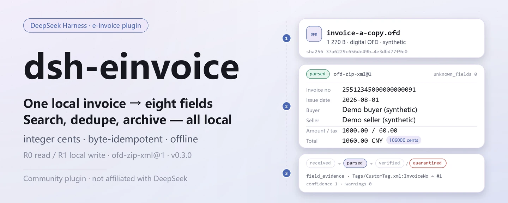

<div align="center">

<picture>
  <source media="(prefers-color-scheme: dark)" srcset="docs/assets/dsh-einvoice-hero-en-dark.webp">
  
</picture>

# dsh-einvoice

**स्थानीय ई-इनवॉइस को खोजने योग्य, डुप्लिकेट-मुक्त और संग्रहणीय बहीखाते में बदलें — मूल फ़ाइलें अछूती, पूरी तरह ऑफ़लाइन।**

DeepSeek Harness के लिए फ़ाइल-स्तरीय चीनी ई-इनवॉइस (OFD/XML) प्लगइन: अंतर्ग्रहण, पार्सिंग, डुप्लिकेट पहचान, रसीद, लाल/नीली लिंकिंग, संग्रह और सत्यापन — सब आपकी मशीन पर; न कर कार्यालय कॉल, न मॉडल कॉल।

[इंस्टॉल](#तीन-चरणों-में-शुरुआत) · [कॉन्फ़िगरेशन](#कॉन्फ़िगरेशन) · [FAQ](#faq) · [简体中文](README.md) · [English](README.en.md) · [Español](README.es.md) · [Português](README.pt.md) · [हिन्दी](README.hi.md)

[](LICENSE)
[](#संगतता)
[](https://www.npmjs.com/package/dsh-einvoice)
[](https://github.com/PerryLink/dsh-einvoice/actions/workflows/ci.yml)
[](#संगतता)

[](https://github.com/PerryLink/dsh-einvoice/stargazers)
[](https://www.npmjs.com/package/dsh-einvoice)
[](https://dshfind.com/plugins/PerryLink/dsh-einvoice?ref=badge)
[](https://dsh.market/)
[](https://gitee.com/perrylink/dsh-einvoice)

```sh
dsh plugin --profile <profile> add dsh-einvoice
```

</div>

<sub>सामुदायिक प्लगइन, DeepSeek से असंबद्ध। कैनोनिकल रिपॉज़िटरी: <https://github.com/PerryLink/dsh-einvoice> (Gitee एक मिरर है)। स्थिति: alpha · केवल सार्वजनिक/सिंथेटिक डेटा से सत्यापित · GA नहीं — कोई ग्राहक डेटा या ग्राहक साक्ष्य नहीं, उत्पादन-तैयारी का दावा नहीं।</sub>

## यह क्या है

एक स्थानीय `.ofd` / `.xml` ई-इनवॉइस पढ़ें, उसका SHA-256 निकालें, मूल प्रति रखें और आठ फ़ील्ड (इनवॉइस संख्या, जारी तिथि, खरीदार और विक्रेता, राशि, कर और कुल), पंक्तियाँ, फ़ील्ड प्रमाण और अज्ञात फ़ील्ड निकालें; फिर सब कुछ एक स्थानीय पूल में जोड़ें जिसे आप इकाई और अवधि के अनुसार क्वेरी, डुप्लिकेट-हटाने और संग्रहित कर सकते हैं। राशि पूर्णांक सेंट में मिलाई जाती है, वही बाइट्स दोबारा अंतर्ग्रहण करना इडेम्पोटेंट है, और एक इकाई के भीतर इनवॉइस संख्या अद्वितीय है। सब कुछ आपकी मशीन पर चलता है — न नेटवर्क, न मॉडल कॉल, न अपलोड, और मूल फ़ाइल कभी संशोधित नहीं होती।

- **किसके लिए उपयुक्त**: दसियों से कुछ सौ ई-इनवॉइस के प्रतिपूर्ति-पूर्व स्व-जाँच; एक ही इनवॉइस को दो इकाइयों द्वारा जमा करने का पता लगाना; अवधि के अनुसार इनवॉइस एकत्र करना, रसीद दर्ज करना, लाल/नीली इनवॉइस जोड़ना और सत्यापन-योग्य संग्रह पैकेज रखना।
- **किसके लिए नहीं**: कर कार्यालय सत्यापन या इनपुट-VAT कटौती (यह पैकेज **ऑफ़लाइन** है और किसी कर API को नहीं बुलाता); स्कैन या फ़ोटो खींची गई इनवॉइस (OCR नहीं); PDF इनवॉइस।

<picture>
  <source media="(prefers-color-scheme: dark)" srcset="docs/assets/dsh-einvoice-flow-v5-dark.svg">
  
</picture>

## तीन चरणों में शुरुआत

1. **इंस्टॉल करें** (एक चैनल चुनें):

   ```sh
   # npm चैनल (अनुशंसित; प्रकाशित वर्ज़न)
   dsh plugin --profile <profile> add dsh-einvoice
   # git चैनल (नवीनतम main; git+https://github.com/PerryLink/dsh-einvoice.git के समतुल्य)
   dsh plugin --profile <profile> add github:PerryLink/dsh-einvoice
   # tarball चैनल: इस रेपो में pnpm pack करके
   dsh plugin --profile <profile> add ./dsh-einvoice-<version>.tgz
   ```

2. **न्यूनतम कॉन्फ़िगरेशन**: प्लगइन-स्तरीय कॉन्फ़िगरेशन कुंजियाँ नहीं हैं — `cordis.patch.yml` केवल एक पंक्ति `insert` करता है और डिफ़ॉल्ट काम करते हैं। केवल एनवायरनमेंट वेरिएबल बदलने पड़ सकते हैं («कॉन्फ़िगरेशन» देखें)।

   ```yaml
   - insert:
       - id: dsh-einvoice
         name: dsh-einvoice
   ```

3. **माउंट होने की पुष्टि करें**:

   ```sh
   dsh --profile <profile> --dump-config | grep dsh-einvoice
   node samples/quickstart/run.mjs
   ```

   क्विकस्टार्ट पैकेज के साथ आने वाली दो सिंथेटिक इनवॉइस (एक XML, एक डिजिटल ई-इनवॉइस OFD) का उपयोग करता है और क्रम से `invoice_ingest → invoice_parse → invoice_dedup → invoice_query` कॉल करता है। अंत में यह आना चाहिए:

   ```text
   ok: quickstart finished (6 tool calls, 1 duplicate invoice found)
   ```

   सत्र के अंदर सीधे कहना भी काफी है — यह `package.json` में `dsh.demo.prompt` के रूप में दिए डेमो प्रॉम्प्ट का अनुवाद है:

   > मैंने एक ही ई-इनवॉइस दो इकाइयों के तहत जमा की (invoice-a.xml और invoice-a-copy.ofd)। दोनों को अंतर्ग्रहण और पार्स करके डुप्लिकेट हटाएँ, और मुझे इनवॉइस संख्या और कुल राशि बताएँ।

**अनइंस्टॉल**: `dsh plugin --profile <profile> remove dsh-einvoice` (या प्रोफ़ाइल पैच से वह पंक्ति हटाएँ)।

<details>
<summary>DSH Desktop मार्केट से इंस्टॉल करें</summary>

सभी PerryLink प्लगइन DSH Desktop के अंतर्निहित मार्केट में ब्राउज़ किए जा सकते हैं: **Market → Sources → Add source → पेस्ट करें** `https://perrylink-dsh-catalog.perrylink.workers.dev/catalog-source.json` **→ चुनें**। इंस्टॉलेशन के लिए मार्केट की npm पहचान जाँच और आपकी पुष्टि आवश्यक रहती है।

</details>

## मुख्य क्षमताएँ

- **फ़ाइल-स्तरीय अंतर्ग्रहण** — `invoice_ingest` अनुमत इनपुट रूट के भीतर एक स्थानीय OFD/XML पढ़ता है, SHA-256 निकालता है और मूल प्रति को `originals/` में `0600` मोड के साथ रखता है; वही बाइट्स दोबारा अंतर्ग्रहण करने पर नया रिकॉर्ड बनाने के बजाय मौजूदा `doc_id` लौटता है।
- **आठ-फ़ील्ड पार्सिंग** — `invoice_parse` पुराने OFD (`Attachs/original_invoice.xml`), डिजिटल ई-इनवॉइस OFD (`Tags/CustomTag.xml` + `ObjectRef`) और स्वतंत्र XML पर `ofd-zip-xml@1` एडाप्टर चलाता है; आठ फ़ील्ड, पंक्तियाँ, `field_evidence` (कौन-सा फ़ील्ड किस नोड से आया) और `unknown_fields` लौटाता है।
- **स्थानीय पूल क्वेरी** — `invoice_query` इकाई, अवधि, जीवनचक्र या टेक्स्ट से स्थिर पेजिंग के साथ फ़िल्टर करता है; हर पंक्ति में `doc_id`, इनवॉइस संख्या, पक्ष, राशि और पार्सर वर्ज़न होते हैं।
- **डुप्लिकेट पहचान** — `invoice_dedup` इनवॉइस संख्या से समूह बनाता है और संख्या न होने पर विक्रेता कर-आईडी + जारी तिथि + कुल से; यह रीड-ओनली है, रिकॉर्ड न मिलाता है न बदलता है।
- **मैन्युअल समीक्षा कतार** — `invoice_review_queue` पार्स की गई इनवॉइस को स्थानीय समीक्षा के लिए कतार में डालता है और अपेक्षित खरीदार कर-आईडी के सापेक्ष `entity_mismatch` / `missing_buyer_tax_id` चिह्नित कर सकता है; कर कार्यालय से कभी संपर्क नहीं करता।
- **स्थानीय रसीदें** — `invoice_record_receipt` स्थानीय रसीद फ़ाइल का हैश निकालता है, अपरिवर्तनीय रसीद जोड़ता है और जीवनचक्र आगे बढ़ाता है; `verification_source=local_receipt`, `tax_verified=false` लौटाता है और स्पष्ट रूप से कर-कार्यालय सत्यापन नहीं है।
- **लाल/नीली लिंकिंग** — `invoice_redlink` ऋणात्मक लाल इनवॉइस को उसकी नीली इनवॉइस से जोड़ता है और आवंटन तथा राशि / कर डेल्टा सहेजता है; किसी दूसरी नीली इनवॉइस से जोड़ने पर `E_INV_REDLINK_BOUND` आता है, चुपचाप पुनःबाइंड नहीं होता।
- **संग्रह, जाँच और पुनर्स्थापन** — `invoice_archive` `manifest.json`, मूल प्रतियों और रसीदों के साथ नियतात्मक ZIP बनाता है; `invoice_check` मैनिफ़ेस्ट हैश, सदस्य हैश, गुम फ़ाइलें और path traversal जाँचता है; `invoice_restore` सत्यापन पास होने पर ही लिखता है।
- **कर-आईडी और कोड सूची जाँच** — `invoice_tax_id_check` 18-अक्षर के एकीकृत सामाजिक ऋण कोड (GB 32100-2015 mod-31 चेक अक्षर) को मान्य करता है; `invoice_code_check` मुद्रा / देश / VAT श्रेणी कोड (EN 16931) जाँचता है; दोनों रीड-ओनली हैं।
- **पूरी तरह स्थानीय** — स्रोत में कोई `fetch` / HTTP / DNS / WebSocket कॉल नहीं; कर कार्यालय, इनवॉइस सत्यापन प्लेटफ़ॉर्म, ERP या क्लाउड से कोई कनेक्शन नहीं।

### टूल सतह

टूल नाम स्थिर API हैं (रनटाइम आउटपुट से मेल खाते हैं, अंग्रेज़ी में रखे गए हैं); विवरण स्थानीयकृत हैं। लिखने वाले टूल **R1 (स्थानीय लेखन)**, रीड-ओनली टूल **R0** चिह्नित हैं।

| टूल | उद्देश्य | जोखिम |
|---|---|---|
| `invoice_ingest` | एक स्थानीय OFD/XML अंतर्ग्रहण करें: पथ अनुमति-सूची, ≤50 MB, SHA-256, मूल प्रतिधारण, बाइट्स के आधार पर इडेम्पोटेंट | R1 स्थानीय लेखन |
| `invoice_parse` | पुराने OFD `Attachs/original_invoice.xml` या डिजिटल ई-इनवॉइस `Tags/CustomTag.xml` को पार्स करें; आठ फ़ील्ड, पंक्तियाँ, फ़ील्ड प्रमाण और अज्ञात फ़ील्ड लौटाएँ | R0 रीड-ओनली |
| `invoice_query` | इकाई, अवधि, जीवनचक्र या टेक्स्ट से स्थानीय पूल क्वेरी करें, स्थिर पेजिंग (प्रति पृष्ठ 1–200) | R0 रीड-ओनली |
| `invoice_dedup` | इनवॉइस संख्या, या विक्रेता + तिथि + कुल से डुप्लिकेट समूहित करें | R0 रीड-ओनली |
| `invoice_review_queue` | पार्स की गई इनवॉइस को स्थानीय मैन्युअल समीक्षा कतार में डालें; वैकल्पिक खरीदार-कर-आईडी बेमेल चिह्न | R1 स्थानीय लेखन |
| `invoice_record_receipt` | स्थानीय रसीद का हैश निकालें, जोड़ें और जीवनचक्र आगे बढ़ाएँ; `verification_source=local_receipt`, `tax_verified=false` | R1 स्थानीय लेखन |
| `invoice_redlink` | ऋणात्मक लाल इनवॉइस को उसकी नीली इनवॉइस से जोड़ें और आवंटन व डेल्टा सहेजें | R1 स्थानीय लेखन |
| `invoice_archive` | स्थानीय संग्रह निर्देशिका में मैनिफ़ेस्ट + मूल + रसीदों वाला नियतात्मक ZIP बनाएँ, फिर स्वयं जाँचें | R1 स्थानीय लेखन |
| `invoice_check` | मैनिफ़ेस्ट/सदस्य हैश, गुम फ़ाइलें और path traversal जाँचें; रीड-ओनली | R0 रीड-ओनली |
| `invoice_restore` | सत्यापित संग्रह को स्थानीय पुनर्स्थापन रूट में बहाल करें; जाँच में विफल को अस्वीकार करें | R1 स्थानीय लेखन |
| `invoice_tax_id_check` | 18-अक्षर के एकीकृत सामाजिक ऋण कोड (GB 32100-2015 mod-31) को मान्य करें | R0 रीड-ओनली |
| `invoice_code_check` | मुद्रा / देश / VAT श्रेणी कोड सूचियाँ (EN 16931) जाँचें | R0 रीड-ओनली |

`invoice_verify` और `invoice_receipt` `invoice_review_queue` / `invoice_record_receipt` के अप्रचलित उपनाम के रूप में बने रहते हैं; नया कोड नए नामों का उपयोग करे।

### इनपुट और आउटपुट

इनपुट:

- एक स्थानीय `.ofd` (डिजिटल ई-इनवॉइस `Tags/CustomTag.xml`, या पुराना `Attachs/original_invoice.xml`) या `.xml` ई-इनवॉइस; UTF-8; प्रति फ़ाइल अधिकतम 50 MB; जारीकर्ता से डाउनलोड या वित्तीय सिस्टम से निर्यात।
- इनपुट रूट `DSH_EINVOICE_INPUT_ROOTS` से आते हैं (डिफ़ॉल्ट: होस्ट प्रक्रिया का cwd); पथ `realpath` से हल होते हैं और सिमलिंक एस्केप अस्वीकार किए जाते हैं।
- शामिल नमूने: `samples/quickstart/input/invoice-a.xml` और `invoice-a-copy.ofd` (सिंथेटिक: गढ़ी हुई इनवॉइस संख्या, स्पष्ट रूप से नकली कर-आईडी `91330106TESTBUYER0` / `91310115TESTSELLER`)।

आउटपुट:

- इनवॉइस संख्या, जारी तिथि, खरीदार और विक्रेता, पूर्णांक सेंट में राशि / कर / कुल, पंक्तियाँ, फ़ील्ड प्रमाण और अज्ञात फ़ील्ड; डुप्लिकेट समूह और क्वेरी परिणाम।
- मूल प्रतियाँ और इंडेक्स `$DSH_HOME/storages/dsh-einvoice` में (`DSH_EINVOICE_HOME` से बदला जा सकता है); **मूल फ़ाइल कभी संशोधित नहीं होती**; संग्रह और पुनर्स्थापन `archives/` और `restore/` में जाते हैं।
- हर त्रुटि में एक `E_INV_…` कोड, सीधा संदेश और एक अगली कार्रवाई होती है, ताकि आप सीधे कार्रवाई कर सकें।

### उदाहरण

यह पंक्ति चिपकाएँ (`package.json` में `dsh.demo.prompt` के रूप में दिया डेमो प्रॉम्प्ट का अनुवाद):

```text
मैंने एक ही ई-इनवॉइस दो इकाइयों के तहत जमा की (invoice-a.xml और invoice-a-copy.ofd)। दोनों को अंतर्ग्रहण और पार्स करके डुप्लिकेट हटाएँ, और मुझे इनवॉइस संख्या और कुल राशि बताएँ।
```

या स्वयं चलाएँ (वास्तविक रन — स्क्रीनशॉट इसी कमांड से है):

```sh
node samples/quickstart/run.mjs
```


*सिंथेटिक नमूने → गोल्ड फ़ाइल `samples/quickstart/expected/result.json`; कमांड और आउटपुट हैश `screenshots.json` में दर्ज हैं (2026-11-02 का वास्तविक रन)।*

## मापे गए आँकड़े

सार्वजनिक/सिंथेटिक स्वीकृति `scripts/acceptance.mjs` से दोबारा चलाई जाती है; विवरण `ACCEPTANCE.csv` में है। ये उसकी 10 पंक्तियाँ हैं, यथामूल्य उदृत (पूरी फ़ाइल में `script` और `evidence_sha256` भी हैं):

```csv
req_id,metric,threshold,actual,pass,source,counted
SKU-04-A01,八字段完整率（S1 合成样本）,>=0.98,1,true,public/synthetic,false
SKU-04-A02,扫描/OCR（未实现）,out_of_scope,out_of_scope,false,public/synthetic,false
SKU-04-A06,单票解析 P95（S1）,<20s,0.0027510999999999512,true,public/synthetic,false
SKU-04-A07,负样本处理率 + 字段证据覆盖（S1）,100%,1,true,public/synthetic,false
SKU-04-A08,统一社会信用代码校验位（GB 32100-2015）,1/1,1,true,public/synthetic,false
SKU-04-A09,EN 16931 代码表（币种/国家/税类）,0 issues,0,true,public/synthetic,false
SKU-04-A05,回执完整率（S2 单票）,100%,1,true,public/synthetic,false
SKU-04-A03,红蓝勾稽（S3 单对）,100%,1,true,public/synthetic,false
SKU-04-A04,归档复原（S3 单包）,100%,1,true,public/synthetic,false
PS1-QS01,quickstart 样例与金标一致,1/1,1,true,synthetic/quickstart,true
```

`SKU-04-A02` में `pass=false` है क्योंकि स्कैनिंग / OCR स्पष्ट रूप से दायरे से बाहर और अक्रियान्वित है — यह रिग्रेशन नहीं है। बाकी SKU पंक्तियाँ सार्वजनिक/सिंथेटिक fixture जाँच हैं (`counted=false`); केवल `PS1-QS01` शामिल नमूने की स्थानीय पुनरुत्पत्ति है (`counted=true`)। एक इनवॉइस के पार्स का मापा गया P95 ≈ `0.00275 s` (सीमा `<20 s`)। इसमें से कोई भी ग्राहक रन नहीं है और कोई आउटपुट नहीं गढ़ा गया।

## कॉन्फ़िगरेशन

इस प्लगइन में कोई Schemastery `Config` कुंजी नहीं है: `cordis.patch.yml` केवल एक पंक्ति (`id: dsh-einvoice`) `insert` करता है और डिफ़ॉल्ट काम करते हैं। समायोज्य दो एनवायरनमेंट वेरिएबल और टूल तर्क हैं।

| वेरिएबल | डिफ़ॉल्ट | अर्थ |
|---|---|---|
| `DSH_EINVOICE_HOME` | `$DSH_HOME/storages/dsh-einvoice` | मूल प्रतियों (`originals/`), संग्रह (`archives/`), पुनर्स्थापन (`restore/`) और स्थानीय पूल का आधार निर्देशिका; `DSH_HOME` न होने पर होस्ट प्रक्रिया के cwd के नीचे `storages/dsh-einvoice` |
| `DSH_EINVOICE_INPUT_ROOTS` | होस्ट प्रक्रिया का cwd | `invoice_ingest` / `invoice_record_receipt` के लिए अनुमत इनपुट रूट, `path.delimiter` से अलग (Windows पर `;`) |

सबसे अधिक उपयोग किए जाने वाले टूल तर्क:

| पैरामीटर | डिफ़ॉल्ट | लागू होता है | अर्थ |
|---|---|---|---|
| `entity_id` | `default` (केवल `ingest`) | `invoice_ingest` / `query` / `review_queue` / `archive` | कानूनी इकाई id; एक इकाई के भीतर इनवॉइस संख्या अद्वितीय है |
| `page` | `50` | `invoice_query` | पृष्ठ आकार, 1–200 |
| `profile` | `ofd-zip-xml` | `invoice_parse` | पार्सर प्रोफ़ाइल; इस पैकेज में केवल `ofd-zip-xml` |
| `ocr` | `off` | `invoice_parse` | यह पैकेज कोई OCR नहीं चलाता और केवल `off` स्वीकार करता है |
| `limit` | `100` | `invoice_review_queue` | इस कॉल में कतार की अधिकतम प्रविष्टियाँ, 1–200 |
| `include_receipts` | `true` | `invoice_archive` | क्या रसीदें संग्रह में पैक हों |

<details>
<summary>त्रुटि कोड और समस्या निवारण</summary>

पूरी त्रुटि-कोड तालिका (20 कोड, पुनःप्रयास क्षमता और उपयोगकर्ता कार्रवाई सहित) [`docs/configuration.md`](docs/configuration.md) में है; लक्षण / कारण / कार्रवाई चरण [`TROUBLESHOOTING.md`](TROUBLESHOOTING.md) में हैं। सबसे सामान्य:

| कोड | कब आता है | अगला कदम |
|---|---|---|
| `E_INV_FILE_UNREADABLE` | पथ मौजूद नहीं, 0 बाइट, या 50 MB से अधिक | जाँचें कि पथ इनपुट रूट के अंतर्गत है, या शामिल नमूने से शुरू करें |
| `E_INV_PATH_NOT_ALLOWED` | फ़ाइल `DSH_EINVOICE_INPUT_ROOTS` के बाहर है | फ़ाइल को इनपुट रूट में ले जाएँ, या वेरिएबल बढ़ाएँ |
| `E_INV_DOC_NOT_FOUND` | `doc_id` कभी अंतर्ग्रहण नहीं हुआ | पहले `invoice_ingest` चलाएँ |
| `E_INV_DUP_CONFLICT` | उसी `entity_id` के तहत इनवॉइस संख्या पहले से है | `invoice_query` का उपयोग करें, या दूसरा `entity_id` चुनें |
| `E_INV_OFD_UNSUPPORTED` | ZIP OFD नहीं है, या भीतर मान्यता-योग्य इनवॉइस XML नहीं है | जारीकर्ता का मूल `.ofd` लें; PDF / चित्र समर्थित नहीं |
| `E_INV_XML_SCHEMA_DRIFT` | कुल ≠ राशि + कर, या संरचना बदल गई | `field_evidence` से नोड खोजें; पुष्टि करें कि इनवॉइस दोबारा संपादित नहीं हुई |

</details>

## FAQ

<details>
<summary>डेटा वास्तव में कहाँ रहता है? क्या मेरी मूल फ़ाइलें छूई जाती हैं?</summary>

मूल प्रतियाँ सामग्री हैश के अनुसार `$DSH_HOME/storages/dsh-einvoice/originals/` में (मोड `0600`) रखी जाती हैं, इंडेक्स स्थानीय `fin_invoice` स्टोरेज डोमेन में रहता है, संग्रह पैकेज `archives/` में जाते हैं और पुनर्स्थापन `restore/` में। इनपुट फ़ाइलें रीड-ओनली हैं — टूल उन्हें कभी नहीं लिखते और कोई अपलोड पथ नहीं है।

</details>

<details>
<summary>क्या यह मेरी असली इनवॉइस संभाल सकता है? क्या कर कार्यालय से सत्यापन करता है?</summary>

यह मानक OFD/XML ई-इनवॉइस को स्थानीय रूप से पार्स करता है, लेकिन पैकेज alpha है और केवल सार्वजनिक/सिंथेटिक डेटा से सत्यापित है — यह लेखापरीक्षा, प्रतिपूर्ति या भुगतान का निष्कर्ष नहीं है। असली डेटा उपयोग से पहले अनाम करें और मानव समीक्षक रखें। **कर-कार्यालय सत्यापन नहीं**: `invoice_record_receipt` केवल स्थानीय रसीद दर्ज करता है (`verification_source=local_receipt`, `tax_verified=false`) और कभी कर कार्यालय या इनवॉइस सत्यापन प्लेटफ़ॉर्म से नहीं जुड़ता।

</details>

<details>
<summary>एक ही इनवॉइस दोबारा पार्स करने पर `E_INV_DUP_CONFLICT` क्यों आता है?</summary>

एक `entity_id` के भीतर इनवॉइस संख्या अद्वितीय है; यह डुप्लिकेट अंतर्ग्रहण से पूल की रक्षा करता है और पार्स विफलता नहीं है। मौजूदा रिकॉर्ड देखने के लिए `invoice_query` का उपयोग करें; यदि वही इनवॉइस वास्तव में दो इकाइयों द्वारा जमा की गई थी, तो उसे दूसरे `entity_id` के तहत पार्स करें — शामिल नमूना ठीक यही दिखाता है।

</details>

<details>
<summary>पार्स किए गए फ़ील्ड मेल नहीं खाते — अब क्या?</summary>

पहले `field_evidence` देखें (हर फ़ील्ड किस XML नोड या `ObjectRef` से आया) और `unknown_fields` (इनवॉइस में मौजूद पर इस पैकेज द्वारा अप्रयुक्त); राशि जाँच केवल कुल = राशि + कर मानती है। `invoice_parse` से पहले `invoice_ingest` चलना चाहिए; संरचनात्मक बदलाव चुपचाप अनुमान लगाने के बजाय `E_INV_XML_SCHEMA_DRIFT` देता है।

</details>

<details>
<summary>इंस्टॉल / माउंट नहीं हो रहा — अब क्या?</summary>

`node --version` को `>=24.9 <25` और `dsh --version` को `>=0.2.1-rc.3 <0.4.0` के लिए जाँचें; फिर `dsh --profile <profile> --dump-config | grep dsh-einvoice` से माउंट की पुष्टि करें। पूरे चरण [`TROUBLESHOOTING.md`](TROUBLESHOOTING.md) में हैं।

</details>

## सुरक्षा सीमाएँ

- **न नेटवर्क, न मॉडल कॉल।** स्रोत में कोई `fetch` / HTTP / DNS / WebSocket कॉल नहीं; `package.json` का डेमो मेटाडेटा भी `network: false` घोषित करता है। इनपुट और आउटपुट स्थानीय रहते हैं।
- **मूल फ़ाइलें कभी संशोधित नहीं होतीं।** लेखन केवल `$DSH_EINVOICE_HOME` (डिफ़ॉल्ट `$DSH_HOME/storages/dsh-einvoice`) के अंतर्गत `originals/`, `archives/`, `restore/` और स्थानीय स्टोरेज डोमेन में होता है; मूल प्रतियाँ `0600` मोड में लिखी जाती हैं।
- **इनपुट पथ अनुमति-सूची।** पथ `realpath` से हल होते हैं और `DSH_EINVOICE_INPUT_ROOTS` के अंतर्गत रहने चाहिए; सिमलिंक एस्केप, खाली फ़ाइलें, गैर-नियमित फ़ाइलें और 50 MB से बड़ी फ़ाइलें अस्वीकार की जाती हैं।
- **सीमित OFD अनज़िप।** अधिकतम 1000 प्रविष्टियाँ और 100 MB अनकंप्रेस्ड; XML एंटिटी प्रोसेसिंग बंद है, जिससे ज़िप बम और एंटिटी विस्तार रुकते हैं।
- **संग्रह में छेड़छाड़ और path traversal गार्ड।** `invoice_check` मैनिफ़ेस्ट हैश, सदस्य हैश, गुम फ़ाइलें और path traversal जाँचता है; `pkg_id` को `^pkg_[0-9a-f]{16}$` से मेल खाना चाहिए, पुनर्स्थापन लक्ष्य पुनर्स्थापन रूट के अंतर्गत रहना चाहिए, और `invoice_restore` जाँच में विफल पैकेज अस्वीकार करता है।
- **डुप्लिकेट सुरक्षा।** वही बाइट्स दोबारा अंतर्ग्रहण करना `source_sha256` से इडेम्पोटेंट है; एक `entity_id` के भीतर इनवॉइस संख्या अद्वितीय है; लाल इनवॉइस को दूसरी नीली इनवॉइस से फिर जोड़ना अस्वीकार किया जाता है (`E_INV_REDLINK_BOUND`)।
- **एकसमान त्रुटियाँ, ठोस विफलताएँ।** विफलताओं में एक `E_INV_…` कोड, सीधा संदेश और एक अगला कदम होता है; असमर्थित इनपुट चुपचाप घटने के बजाय ठोस रूप से विफल होता है।
- **कोई छिपी सतह नहीं।** न R2/R3 टूल, न MCP एक्सपोज़र, न क्लाइंट आधा; होस्ट केवल `tools` और `storageDomain` सेवाएँ माउंट करता है।

## अनुमतियाँ और डेटा

- **पढ़ता है**: आपके बताए `.ofd` / `.xml` ई-इनवॉइस और रसीद फ़ाइलें (इनपुट रूट के अंतर्गत होनी चाहिए); कोई अन्य निर्देशिका नहीं।
- **लिखता है**: `$DSH_HOME/storages/dsh-einvoice` (मूल प्रतियाँ, इंडेक्स, संग्रह, पुनर्स्थापन); मूल फ़ाइलें अछूती।
- **नेटवर्क**: नहीं (स्रोत में कोई HTTP / DNS / WebSocket कॉल नहीं)।
- **बाहरी सिस्टम**: कोई नहीं (कर कार्यालय, इनवॉइस सत्यापन प्लेटफ़ॉर्म या ERP नहीं; कोई अपलोड नहीं)।
- **डेटा सीमा**: केवल सार्वजनिक/सिंथेटिक नमूनों से सत्यापित; कोई ग्राहक डेटा या ग्राहक साक्ष्य नहीं।

## ज्ञात सीमाएँ

- **केवल सार्वजनिक/सिंथेटिक डेटा से सत्यापित।** हर स्वीकृति पंक्ति सार्वजनिक या सिंथेटिक fixture से आती है (`ACCEPTANCE.csv` में SKU पंक्तियाँ `counted=false`; PS1-QS01 नमूने की स्थानीय पुनरुत्पत्ति है, `counted=true`); कोई ग्राहक डेटा या ग्राहक साक्ष्य नहीं।
- **alpha / आंशिक / गिना नहीं गया / GA नहीं।** उत्पादन-तैयारी का दावा नहीं; लेखापरीक्षा, प्रतिपूर्ति या भुगतान का निष्कर्ष नहीं।
- **OCR नहीं।** स्कैन, फ़ोटो खींची गई और PDF इनवॉइस समर्थित नहीं; `invoice_parse` केवल `ocr: off` स्वीकार करता है।
- **कर-कार्यालय सत्यापन नहीं।** रसीद केवल स्थानीय रिकॉर्ड है (`tax_verified=false`); इनपुट-VAT कटौती या कर जाँच के लिए आधिकारिक माध्यम उपयोग करें।
- **एक फ़ाइल का अंतर्ग्रहण।** प्रति कॉल एक OFD/XML, अधिकतम 50 MB; बैच के लिए `invoice_ingest` दोहराएँ।
- **केवल CNY और एक पार्सर।** मुद्रा `CNY` पर स्थिर और राशि पूर्णांक सेंट में; एकमात्र पार्सर `ofd-zip-xml` (संस्करण `ofd-zip-xml@1`) है, और अज्ञात प्रोफ़ाइल `E_INV_UNKNOWN_IMPL` देता है।
- **स्टोरेज JSON KV है।** `fin_invoice` डोमेन में कोई विदेशी कुंजी, क्रॉस-टेबल ट्रांज़ैक्शन या माइग्रेशन नहीं; `(entity_id, invoice_no)` की अद्वितीयता एप्लिकेशन कोड में जाँची जाती है।
- **कोई क्लाइंट UI नहीं।** पैकेज केवल host है और कोई slot या क्लाइंट पैकेज पंजीकृत नहीं करता; सब कुछ टूल सतह से होता है।
- **सटीक सीमाएँ।** प्रत्येक टूल की सीमाएँ ठीक «मुख्य क्षमताएँ» टूल तालिका और `ACCEPTANCE.csv` हैं।

## अन्य DSH प्लगइनों के साथ इंटरऑपरेबिलिटी

- **नेमस्पेस वाले टूल नाम।** सभी टूल `invoice_*` के अंतर्गत हैं और अंतर्निहित टूल या किसी अन्य प्लगइन का खुला नाम नहीं लेते।
- **होस्ट सतह नहीं चुराता।** कोई कमांड, क्लाइंट slot, `webServer` रूट या सेवा कुंजी पंजीकृत नहीं करता; केवल `tools` और `storageDomain` होस्ट सेवाएँ इंजेक्ट करता है।
- **स्वतंत्र स्टोरेज डोमेन।** एक ही डोमेन `fin_invoice` (संस्करण 1) उपयोग करता है; टियरडाउन Cordis effect है, इसलिए रोकना या हॉट-रीलोड करना उसे वापस ले लेता है।
- **पूरक ज़िम्मेदारियाँ।** खाता-बही स्तर की जाँच [`dsh-invoice-ledger`](https://github.com/PerryLink/dsh-invoice-ledger) के पास है, और दो-तालिका मिलान [`dsh-excel-reconcile`](https://github.com/PerryLink/dsh-excel-reconcile) के पास; दोनों अलग पैकेज हैं, ज़रूरत पर ही इंस्टॉल करें।

## संगतता

| सतह | स्थिति |
|---|---|
| Harness | DeepSeek Harness `>=0.2.1-rc.3 <0.4.0` (`package.json` में `engines.dsh`) |
| Node | `>=24.9.0 <25` (`.nvmrc`: 24) |
| प्लेटफ़ॉर्म | जहाँ भी DSH चले; केवल स्थानीय फ़ाइलें |
| डेटा | न नेटवर्क, न मॉडल कॉल, न अपलोड |

## इकोसिस्टम और गुणवत्ता

- [Gitee मिरर](https://gitee.com/perrylink/dsh-einvoice) (सिंक मिरर; GitHub कैनोनिकल है)
- [dshfind प्लगइन पेज](https://dshfind.com/plugins/PerryLink/dsh-einvoice) (इंस्टॉल और रैंकिंग)
- [DSH Market](https://dsh.market/) (सूचीबद्ध)
- **1024 स्टोर चैनल**: एक बार `npm i -g dsh1024`, फिर `dsh1024 plugin --profile <profile> add dsh-einvoice` ([deepseek1024.com](https://deepseek1024.com) इंस्टॉल रैंकिंग में गिना जाता है)
- दस्तावेज़: [`TROUBLESHOOTING.md`](TROUBLESHOOTING.md) · [`PRIVACY.md`](PRIVACY.md) · [`SECURITY.md`](SECURITY.md) · [`docs/architecture.md`](docs/architecture.md) · [`docs/configuration.md`](docs/configuration.md)
- इंडेक्स: [डोमेन इंडेक्स](https://perrylink.github.io/dsh-plugins/) · [चेकर परिवार](https://perrylink.github.io/zh/checkers/) · [परिदृश्य लेख](https://perrylink.github.io/dsh-plugins/articles/finops-suite.html)

### संबंधित कार्य और चेकर

सिबलिंग पैकेज और परिवार इंडेक्स: [dsh-bankrec](https://github.com/PerryLink/dsh-bankrec) · [dsh-ap-three-way](https://github.com/PerryLink/dsh-ap-three-way) · [dsh-travel-recon](https://github.com/PerryLink/dsh-travel-recon) · [dsh-finops-suite](https://github.com/PerryLink/dsh-finops-suite)

प्रत्येक चेकर अपने नियम-पैक और वर्ज़न वाला स्वतंत्र पैकेज है; केवल वही इंस्टॉल करें जो चाहिए:

| पैकेज | क्यों प्रासंगिक है |
|---|---|
| [`dsh-invoice-ledger`](https://github.com/PerryLink/dsh-invoice-ledger) | इनवॉइस-बही स्तर पर डुप्लिकेट, अंकगणित, पक्ष और तिथि जाँचें; इस पैकेज की फ़ाइल-स्तरीय पार्सिंग को पूरक करती हैं |
| [`dsh-excel-reconcile`](https://github.com/PerryLink/dsh-excel-reconcile) | जब इनवॉइस पूल को बाहरी बही से मिलाना हो, तब सामान्य दो-तालिका मिलान |

## डेवलपमेंट

```sh
pnpm install --frozen-lockfile
pnpm build && pnpm lint && pnpm typecheck && pnpm test   # tsc बिल्ड + node --test test/*.test.mjs (11 टेस्ट फ़ाइलें)
pnpm gate:sku04                                         # स्वीकृति गेट (ACCEPTANCE.csv)
node scripts/acceptance.mjs                             # सार्वजनिक/सिंथेटिक स्वीकृति दोबारा चलाएँ
node samples/quickstart/run.mjs                         # सिंथेटिक सैंपल; 6 टूल कॉल और 1 डुप्लिकेट समूह अपेक्षित
```

TypeScript स्रोत `src/` में हैं (`src/core/` आठ फ़ील्ड और राशि, `src/adapters/` OFD/XML पार्सिंग, `src/registry/` पार्सर रजिस्ट्री, `src/plugin/` होस्ट फ़ेस); बिल्ड आउटपुट `lib/` में जाता है; fixtures `fixtures/` में और शामिल नमूना `samples/quickstart/` में है। वर्तमान वर्ज़न `0.3.0` (`package.json` से मेल खाता है)। टेस्ट `node --test test/*.test.mjs` से चलते हैं; सार्वजनिक नमूनों के अभाव से होने वाले skip सामान्य हैं, विफलता नहीं (देखें [`TROUBLESHOOTING.md`](TROUBLESHOOTING.md))। हेडर बैनर और संरचना आरेख [`scripts/gen-readme-assets.py`](scripts/gen-readme-assets.py) से प्रोग्रामेटिक रूप से बनते हैं (Python: Pillow से 1440×576 के चार webp बैनर और संरचना आरेख के लिए हाथ से लिखा 1100×660 का SVG जोड़ा), और दोबारा चलाए जा सकते हैं।

Topics: `deepseek-harness`, `dsh`, `dsh-plugin`, `einvoice`, `invoice`, `ofd`, `perrylink`, `finance`

## परिवार और आभार

यह प्रोजेक्ट [PerryLink](https://github.com/PerryLink) के DeepSeek Harness प्लगइन परिवार का हिस्सा है (सभी Apache-2.0)। अगर यह उपयोगी लगे, तो **एक स्टार अगले व्यक्ति को इसे खोजने में मदद करता है** — इसके पीछे कुछ भी लॉक नहीं है।

- [@PerryLink](https://github.com/PerryLink) — निर्माता और रखरखावकर्ता: OFD/XML पार्सर, आठ-फ़ील्ड सामान्यीकरण, इनवॉइस पूल और डुप्लिकेट पहचान, रसीद / लाल-नीली लिंकिंग / संग्रह सत्यापन, quickstart और स्वीकृति सूट, और पाँच-भाषा दस्तावेज़।

## लाइसेंस

[LICENSE](LICENSE) (Apache License 2.0) © 2026 dsh-einvoice contributors; `NOTICE` और `THIRD-PARTY-NOTICES` भी देखें।

<p align="center"><sub>Apache-2.0 · सामुदायिक प्लगइन, DeepSeek से असंबद्ध।</sub></p>
