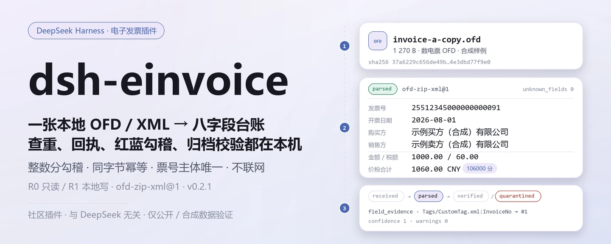
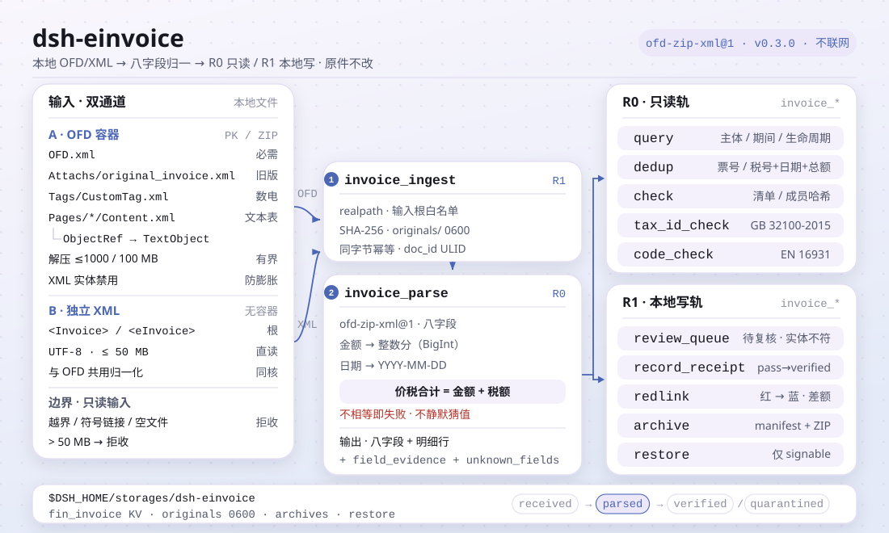

<div align="center">

<picture>
  <source media="(prefers-color-scheme: dark)" srcset="docs/assets/dsh-einvoice-hero-zh-dark.webp">
  
</picture>

# dsh-einvoice

**把本地电子发票变成可查、可去重、可归档的台账——原件不动，全程不联网。**

面向 DeepSeek Harness 的文件级中国电子发票（OFD/XML）插件：入库、解析、查重、回执、红蓝勾稽、归档与校验都在本机完成；不调税局接口、不调模型。

[安装](#三步上手) · [配置](#配置) · [FAQ](#faq) · [简体中文](README.md) · [English](README.en.md) · [Español](README.es.md) · [Português](README.pt.md) · [हिन्दी](README.hi.md)

[](LICENSE)
[](#兼容性)
[](https://www.npmjs.com/package/dsh-einvoice)
[](https://github.com/PerryLink/dsh-einvoice/actions/workflows/ci.yml)
[](#兼容性)

[](https://github.com/PerryLink/dsh-einvoice/stargazers)
[](https://www.npmjs.com/package/dsh-einvoice)
[](https://dshfind.com/plugins/PerryLink/dsh-einvoice?ref=badge)
[](https://dsh.market/)
[](https://gitee.com/perrylink/dsh-einvoice)

```sh
dsh plugin --profile <profile> add dsh-einvoice
```

</div>

<sub>社区插件，与 DeepSeek 官方无关。唯一仓库：<https://github.com/PerryLink/dsh-einvoice>（Gitee 为镜像）。状态：alpha · 仅用公开/合成数据验证 · 非 GA——不含客户数据或客户证据，不作生产可用声明。</sub>

## 它是什么

把一张本地 `.ofd` / `.xml` 电子发票读进来，算 SHA-256、留原件，解析出八字段（发票号、开票日期、购销方、金额、税额、价税合计）、明细行、字段证据与未知字段，再按主体与期间归集成可查询、可去重、可归档的本地票据池。金额一律用整数分勾稽，重复入池按字节幂等，同一主体下发票号唯一。全部逻辑在本机完成——不联网、不调用模型、不上传，原始文件不会被修改。

- **适合**：报销前几十到几百张电子发票的自查；同一张发票被两个主体重复提交的排查；按期间把票据归集、出回执、做红蓝勾稽并留一份可校验的归档包。
- **不适合**：需要税局验真、抵扣勾选的场景（本包**不联网**、不调税局接口）；扫描件 / 图片发票（不做 OCR）；PDF 发票。

<picture>
  <source media="(prefers-color-scheme: dark)" srcset="docs/assets/dsh-einvoice-flow-v5-dark.svg">
  
</picture>

## 三步上手

1. **安装**（三选一）：

   ```sh
   # npm 通道（推荐，已发布版本）
   dsh plugin --profile <profile> add dsh-einvoice
   # git 通道（最新 main；等价于 git+https://github.com/PerryLink/dsh-einvoice.git）
   dsh plugin --profile <profile> add github:PerryLink/dsh-einvoice
   # tarball 通道：本仓库 pnpm pack 后
   dsh plugin --profile <profile> add ./dsh-einvoice-<version>.tgz
   ```

2. **最小配置**：没有插件级配置键——`cordis.patch.yml` 只 `insert` 一行，默认即可用；需要改的只有环境变量（见「配置」）。

   ```yaml
   - insert:
       - id: dsh-einvoice
         name: dsh-einvoice
   ```

3. **验证已生效**：

   ```sh
   dsh --profile <profile> --dump-config | grep dsh-einvoice
   node samples/quickstart/run.mjs
   ```

   quickstart 用随包的两份合成票（XML + 数电票 OFD）依次调用 `invoice.ingest → invoice.parse → invoice.dedup → invoice.query`，结尾应输出：

   ```text
   ok: quickstart finished (6 tool calls, 1 duplicate invoice found)
   ```

   在会话里也可以直接说（`package.json` 的 `dsh.demo.prompt`）：

   > 我把同一张电子发票分别报给了两家主体（invoice-a.xml 和 invoice-a-copy.ofd），帮我入库解析后查重，告诉我发票号和价税合计。

**卸载**：`dsh plugin --profile <profile> remove dsh-einvoice`（或从 profile patch 删掉该行）。

<details>
<summary>从 DSH Desktop 市场安装</summary>

所有 PerryLink 插件均可在 DSH Desktop 内置市场中浏览：**市场 → 来源 → 添加来源 → 粘贴** `https://perrylink-dsh-catalog.perrylink.workers.dev/catalog-source.json` **→ 选中**。安装仍需通过市场的 npm 身份校验与你的确认。

</details>

## 核心能力

- **文件级入库** —— `invoice.ingest` 读取一个本地 OFD/XML，限制在输入根目录内，算 SHA-256、把原件按 `0600` 存进 `originals/`；同一份字节重复入库直接返回既有 `doc_id`，不产生新记录。
- **八字段解析** —— `invoice.parse` 通过 `ofd-zip-xml@1` 适配器处理旧版 OFD（`Attachs/original_invoice.xml`）、数电票 OFD（`Tags/CustomTag.xml` + `ObjectRef`）与独立 XML；返回八字段、明细行、`field_evidence`（字段来自哪个节点）与 `unknown_fields`。
- **本地票据池查询** —— `invoice.query` 按主体、期间、生命周期或文本匹配，稳定分页；返回 `doc_id`、发票号、购销方、金额与解析版本。
- **重复检测** —— `invoice.dedup` 按发票号分组；没有票号时退回「销售方税号 + 开票日期 + 价税合计」分组；只读，不合并、不改写记录。
- **人工复核队列** —— `invoice.review_queue` 把已解析票据排进本地待复核队列，可给出期望购买方税号并标记 `entity_mismatch` / `missing_buyer_tax_id`；不联系税局。
- **本地回执** —— `invoice.record_receipt` 对本地回执文件算哈希、追加不可变回执并推进生命周期；返回 `verification_source=local_receipt`、`tax_verified=false`，明确不是税局验真。
- **红蓝勾稽** —— `invoice.redlink` 把负数红字发票绑定到蓝字发票，记录分配额与金额 / 税额差额；已绑定到另一张蓝票时报 `E_INV_REDLINK_BOUND`，不静默改绑。
- **归档、校验与恢复** —— `invoice.archive` 生成含 `manifest.json`、原件与回执的确定性 ZIP；`invoice.check` 校验清单哈希、成员哈希、缺失文件与路径穿越；`invoice.restore` 只在归档校验通过后写入本地恢复根目录。
- **税号与代码表校验** —— `invoice.tax_id_check` 校验 18 位统一社会信用代码（GB 32100-2015 mod-31 校验位）；`invoice.code_check` 检查币种 / 国家 / 税类代码（EN 16931）；两者都只读。
- **纯本地** —— 源码中没有 `fetch` / HTTP / DNS / WebSocket 调用；不连税局、发票查验平台、ERP 或云服务。

### 工具面

工具名是稳定 API（与运行时输出一致，保持英文）；说明已本地化。写文件的工具标 **R1（本地写）**，只读工具标 **R0**。

| 工具 | 用途 | 风险 |
|---|---|---|
| `invoice.ingest` | 导入一个本地 OFD/XML：路径白名单、≤50 MB、SHA-256、原件留存、按字节幂等 | R1 本地写 |
| `invoice.parse` | 解析旧版 OFD 的 `Attachs/original_invoice.xml` 或数电票的 `Tags/CustomTag.xml`；返回八字段、明细行、字段证据与未知字段 | R0 只读 |
| `invoice.query` | 按主体、期间、生命周期或文本查询本地票据池，稳定分页（每页 1–200） | R0 只读 |
| `invoice.dedup` | 按发票号，或销售方 + 日期 + 价税合计对重复项分组 | R0 只读 |
| `invoice.review_queue` | 将已解析发票排入本地人工复核队列；可选标记购买方税号不一致 | R1 本地写 |
| `invoice.record_receipt` | 对本地回执算哈希、追加回执并推进生命周期；`verification_source=local_receipt`、`tax_verified=false` | R1 本地写 |
| `invoice.redlink` | 把负数红字发票绑定到蓝字发票，保存分配额与差额 | R1 本地写 |
| `invoice.archive` | 在本地归档目录生成清单 + 原件 + 回执的确定性 ZIP，并自校验 | R1 本地写 |
| `invoice.check` | 校验清单 / 成员哈希、缺失文件及路径穿越；只读 | R0 只读 |
| `invoice.restore` | 把已校验归档恢复到本地恢复根目录；校验不过则拒绝 | R1 本地写 |
| `invoice.tax_id_check` | 校验 18 位统一社会信用代码（GB 32100-2015 mod-31） | R0 只读 |
| `invoice.code_check` | 检查币种 / 国家 / 税类代码表（EN 16931） | R0 只读 |

`invoice.verify` 与 `invoice.receipt` 保留为 `invoice.review_queue` / `invoice.record_receipt` 的弃用别名，仍可调用；新代码请用新名字。

### 输入与输出

输入：

- 本地 `.ofd`（数电票 `Tags/CustomTag.xml` 或旧版 `Attachs/original_invoice.xml`）或 `.xml` 电子发票；UTF-8；单文件 ≤50 MB；来自开票方下载或财务系统导出。
- 输入根目录由 `DSH_EINVOICE_INPUT_ROOTS` 控制（缺省为启动进程的 cwd）；路径经 `realpath` 解析，符号链接逃逸会被拒绝。
- 自带样例：`samples/quickstart/input/invoice-a.xml` 与 `invoice-a-copy.ofd`（合成：发票号自造、税号 `91330106TESTBUYER0` / `91310115TESTSELLER` 明显为假值）。

输出：

- 发票号、开票日期、购销方、金额 / 税额 / 价税合计（整数分）、明细行、字段证据与未知字段；重复分组与查询结果。
- 原件与索引写在 `$DSH_HOME/storages/dsh-einvoice`（可用 `DSH_EINVOICE_HOME` 覆盖），**不改原文件**；归档与恢复分别落在 `archives/` 与 `restore/`。
- 所有错误统一为 `<一句人话>（E_INV_…）｜下一步：<一个动作>`，便于直接照着处理。

### 示例

直接复制这句话（`package.json` 里的演示提示词）：

```text
我把同一张电子发票分别报给了两家主体（invoice-a.xml 和 invoice-a-copy.ofd），帮我入库解析后查重，告诉我发票号和价税合计。
```

也可以自己跑（真实运行，截图即来自这条命令）：

```sh
node samples/quickstart/run.mjs
```


*合成样例 → 金标 `samples/quickstart/expected/result.json`；命令与输出哈希见 `screenshots.json`（2026-11-02 真实运行）。*

## 实测数据

公开 / 合成验收由 `scripts/acceptance.mjs` 重跑，明细落在 `ACCEPTANCE.csv`。以下为其中的 10 行（原样引用；完整列含 `script` 与 `evidence_sha256`）：

```csv
req_id,metric,threshold,actual,pass,source,counted
SKU-04-A01,八字段完整率（S1 合成样本）,>=0.98,1,true,public/synthetic,false
SKU-04-A02,扫描/OCR（未实现）,out_of_scope,out_of_scope,false,public/synthetic,false
SKU-04-A06,单票解析 P95（S1）,<20s,0.0027510999999999512,true,public/synthetic,false
SKU-04-A07,负样本处理率 + 字段证据覆盖（S1）,100%,1,true,public/synthetic,false
SKU-04-A08,统一社会信用代码校验位（GB 32100-2015）,1/1,1,true,public/synthetic,false
SKU-04-A09,EN 16931 代码表（币种/国家/税类）,0 issues,0,true,public/synthetic,false
SKU-04-A05,回执完整率（S2 单票）,100%,1,true,public/synthetic,false
SKU-04-A03,红蓝勾稽（S3 单对）,100%,1,true,public/synthetic,false
SKU-04-A04,归档复原（S3 单包）,100%,1,true,public/synthetic,false
PS1-QS01,quickstart 样例与金标一致,1/1,1,true,synthetic/quickstart,true
```

`SKU-04-A02` 的 `pass=false` 表示「扫描 / OCR 被明确列为范围外、未实现」，不是回归失败；其余 SKU 行都是公开 / 合成 fixture 检查（`counted=false`），只有 `PS1-QS01` 是随包样例的本地复现（`counted=true`）。单票解析 P95 实测约 `0.00275 s`（阈值 `<20 s`）。以上都不是客户运行，没有虚构输出。

## 配置

本插件没有 Schemastery 配置键：`cordis.patch.yml` 只 `insert` 一行（`id: dsh-einvoice`），默认即可用。真正可调的是两个环境变量与工具参数。

| 变量 | 默认值 | 含义 |
|---|---|---|
| `DSH_EINVOICE_HOME` | `$DSH_HOME/storages/dsh-einvoice` | 原件（`originals/`）、归档（`archives/`）、恢复（`restore/`）与本地票据池的基目录；未设 `DSH_HOME` 时退回宿主进程 cwd 下的 `storages/dsh-einvoice` |
| `DSH_EINVOICE_INPUT_ROOTS` | 启动进程的 cwd | `invoice.ingest` / `invoice.record_receipt` 的输入允许根目录，多个用 `path.delimiter` 分隔（Windows 为 `;`） |

最常用的工具参数：

| 参数 | 默认值 | 作用于 | 含义 |
|---|---|---|---|
| `entity_id` | `default`（仅 `ingest`） | `invoice.ingest` / `query` / `review_queue` / `archive` | 法人主体 id；同一主体下发票号唯一 |
| `page` | `50` | `invoice.query` | 每页条数，1–200 |
| `profile` | `ofd-zip-xml` | `invoice.parse` | 解析器 profile；本包只有 `ofd-zip-xml` |
| `ocr` | `off` | `invoice.parse` | 本包不运行 OCR，只接受 `off` |
| `limit` | `100` | `invoice.review_queue` | 本次入队上限，1–200 |
| `include_receipts` | `true` | `invoice.archive` | 是否把回执一起打进归档包 |

<details>
<summary>错误码与故障排查</summary>

完整错误码表（20 个，含是否可重试与用户动作）见 [`docs/configuration.md`](docs/configuration.md)；按症状 / 原因 / 动作组织的排查步骤见 [`TROUBLESHOOTING.md`](TROUBLESHOOTING.md)。最常见的几类：

| 错误码 | 何时出现 | 下一步 |
|---|---|---|
| `E_INV_FILE_UNREADABLE` | 路径不存在、0 字节、超过 50 MB | 确认路径在输入根目录内，或先用自带样例 |
| `E_INV_PATH_NOT_ALLOWED` | 文件不在 `DSH_EINVOICE_INPUT_ROOTS` 下 | 把文件放进输入根目录，或扩大该变量 |
| `E_INV_DOC_NOT_FOUND` | `doc_id` 未入库 | 先 `invoice.ingest` |
| `E_INV_DUP_CONFLICT` | 同一 `entity_id` 下发票号已存在 | 用 `invoice.query` 查已有记录，或换 `entity_id` |
| `E_INV_OFD_UNSUPPORTED` | ZIP 不是 OFD，或票面 XML 不可识别 | 换开票方原始 `.ofd`；PDF / 图片不支持 |
| `E_INV_XML_SCHEMA_DRIFT` | 价税合计 ≠ 金额 + 税额，或结构漂移 | 看 `field_evidence` 定位节点，先确认票面未被二次编辑 |

</details>

## FAQ

<details>
<summary>数据到底存在哪？原文件会被改吗？</summary>

原件按内容哈希存进 `$DSH_HOME/storages/dsh-einvoice/originals/`（`0600`），索引在本地存储域 `fin_invoice`，归档包在 `archives/`，恢复目录在 `restore/`。输入文件只读——工具不会改写原文件，也没有任何上传路径。

</details>

<details>
<summary>能处理我的真实发票吗？能做税局验真吗？</summary>

可以本地解析标准 OFD/XML 电子发票，但本包是 alpha、只用公开 / 合成数据验证，不构成审计、报销或付款结论；真实数据请先脱敏并保留复核人。**不做税局验真**：`invoice.record_receipt` 只记录本地回执（`verification_source=local_receipt`、`tax_verified=false`），不连接税局或发票查验平台。

</details>

<details>
<summary>同一张发票为什么解析两次会报 `E_INV_DUP_CONFLICT`？</summary>

同一 `entity_id` 下发票号唯一，这是防重复入池的保护，不是解析失败。先用 `invoice.query` 查已有记录；若确属两个主体各报一次，换一个 `entity_id` 再解析——自带样例演示的就是这种跨主体查重。

</details>

<details>
<summary>解析结果对不上怎么办？</summary>

先看 `field_evidence`（每个字段来自哪个 XML 节点或 `ObjectRef`）与 `unknown_fields`（票面里有、但本包不用的字段）；金额勾稽只校验「价税合计 = 金额 + 税额」。解析前必须先 `invoice.ingest`；结构漂移会报 `E_INV_XML_SCHEMA_DRIFT`，不会静默猜值。

</details>

<details>
<summary>装不上 / 生效不了怎么办？</summary>

先看 `node --version` 是否满足 `>=24.9 <25`、`dsh --version` 是否在 `>=0.2.1-rc.3 <0.4.0`；再用 `dsh --profile <profile> --dump-config | grep dsh-einvoice` 确认已挂载。完整步骤见 [`TROUBLESHOOTING.md`](TROUBLESHOOTING.md)。

</details>

## 安全边界

- **不联网、不调模型。** 源码中没有 `fetch` / HTTP / DNS / WebSocket 调用；`package.json` 的演示元数据也声明 `network: false`。输入和输出都留在本地。
- **原文件不被修改。** 写操作只落在 `$DSH_EINVOICE_HOME`（缺省 `$DSH_HOME/storages/dsh-einvoice`）下的 `originals/`、`archives/`、`restore/` 与本地存储域；原件以 `0600` 写入。
- **输入路径白名单。** 路径先 `realpath` 解析，必须落在 `DSH_EINVOICE_INPUT_ROOTS` 内；符号链接逃逸、空文件、非普通文件与超过 50 MB 的文件都会被拒绝。
- **OFD 解压有界。** 最多 1000 个条目、解压后最多 100 MB；XML 实体处理被禁用，避免解压炸弹与实体展开。
- **归档防篡改与防穿越。** `invoice.check` 校验清单哈希、成员哈希、缺失文件与目录穿越；`pkg_id` 必须匹配 `^pkg_[0-9a-f]{16}$`，恢复目标必须落在恢复根目录下；校验不过 `invoice.restore` 直接拒绝。
- **重复保护。** 同一字节重复入库按 `source_sha256` 幂等；同一 `entity_id` 下发票号唯一；红字发票改绑到另一张蓝票会被拒绝（`E_INV_REDLINK_BOUND`）。
- **错误格式统一、失败响亮。** 报错统一为 `<一句人话>（E_INV_…）｜下一步：<动作>`；无法处理的输入直接失败，不静默降级。
- **没有隐藏面。** 不注册 R2/R3 工具、不做 MCP 暴露、没有客户端半；宿主只挂 `tools` 与 `storageDomain` 两个服务。

## 权限与数据

- **读**：你指定的 `.ofd` / `.xml` 电子发票与回执文件（必须在输入根目录内）；不读其他目录。
- **写**：`$DSH_HOME/storages/dsh-einvoice`（原件、索引、归档与恢复）；不改原文件。
- **联网**：否（源码中没有 HTTP / DNS / WebSocket 调用）。
- **外部系统**：无（不调税局 / 发票查验平台 / ERP，不上传）。
- **数据边界**：仅公开 / 合成样例验证；不含客户数据或客户证据。

## 已知限制

- **仅公开 / 合成验证。** 所有验收行都来自公开或合成 fixture（`ACCEPTANCE.csv` 中 SKU 行 `counted=false`，PS1-QS01 为随包样例本地复现 `counted=true`）；不含客户数据或客户证据。
- **alpha / partial / not counted / 非 GA。** 不作生产可用声明，不构成审计、报销或付款结论。
- **不做 OCR。** 扫描件、图片发票与 PDF 发票不支持；`invoice.parse` 的 `ocr` 只接受 `off`。
- **不做税局验真。** 回执只是本地记录，`tax_verified=false`；抵扣勾选、税局查验请走官方渠道。
- **只处理单文件入库。** 一次一个 OFD/XML，单文件 ≤50 MB；批量请循环调用 `invoice.ingest`。
- **只支持人民币与内置解析器。** 币种固定 `CNY`，金额用整数分；解析器只有 `ofd-zip-xml`（版本 `ofd-zip-xml@1`），未知 profile 报 `E_INV_UNKNOWN_IMPL`。
- **存储是 JSON KV。** `fin_invoice` 域没有外键、跨表事务或迁移；`(entity_id, invoice_no)` 唯一性在应用层检查。
- **无客户端界面。** 本包是纯 host 形态，不注册 slot / 客户端包；所有操作走工具面。
- **精确边界。** 每个工具的逐项边界以「核心能力」工具表与 `ACCEPTANCE.csv` 为准。

## 与其他 DSH 插件的互操作性

- **工具名带命名空间。** 所有工具都在 `invoice.*` 下，不占用内置工具或其他插件的裸名。
- **不抢宿主表面。** 不注册命令、客户端 slot、`webServer` 路由或服务键；只注入 `tools` 与 `storageDomain` 两个宿主服务。
- **存储域独立。** 使用 `fin_invoice`（version 1）这一个域；关闭走 Cordis effect，停止 / 热重载即可撤销。
- **职责互补。** 台账级核对交给 [`dsh-invoice-ledger`](https://github.com/PerryLink/dsh-invoice-ledger)，两表对账交给 [`dsh-excel-reconcile`](https://github.com/PerryLink/dsh-excel-reconcile)；它们各自是独立包，按需安装。

## 兼容性

| 维度 | 状态 |
|---|---|
| Harness | DeepSeek Harness `>=0.2.1-rc.3 <0.4.0`（`package.json` 的 `engines.dsh`） |
| Node | `>=24.9.0 <25`（`.nvmrc`：24） |
| 平台 | 任何 DSH 可运行处；仅本地文件 |
| 数据 | 不联网、不调用模型、不上传 |

## 生态与质量

- [Gitee 镜像](https://gitee.com/perrylink/dsh-einvoice)（同步镜像，以 GitHub 为准）
- [dshfind 插件页](https://dshfind.com/plugins/PerryLink/dsh-einvoice)（安装量与排名）
- [DSH Market](https://dsh.market/)（已上架）
- **1024 商店渠道**：先 `npm i -g dsh1024`，再 `dsh1024 plugin --profile <profile> add dsh-einvoice`（计入 [deepseek1024.com](https://deepseek1024.com) 安装排行）
- 文档：[`TROUBLESHOOTING.md`](TROUBLESHOOTING.md)（故障排查）· [`PRIVACY.md`](PRIVACY.md) · [`SECURITY.md`](SECURITY.md) · [`docs/architecture.md`](docs/architecture.md) · [`docs/configuration.md`](docs/configuration.md)
- 索引：[领域索引](https://perrylink.github.io/dsh-plugins/) · [Checker 家族](https://perrylink.github.io/zh/checkers/) · [场景文章](https://perrylink.github.io/dsh-plugins/articles/finops-suite.html)

### 相关项目与核查器

兄弟包与家族索引：[dsh-bankrec](https://github.com/PerryLink/dsh-bankrec) · [dsh-ap-three-way](https://github.com/PerryLink/dsh-ap-three-way) · [dsh-travel-recon](https://github.com/PerryLink/dsh-travel-recon) · [dsh-finops-suite](https://github.com/PerryLink/dsh-finops-suite)

相关核查器（各自是独立包，带独立规则包与版本；只装需要的）：

| 包 | 为什么相关 |
|---|---|
| [`dsh-invoice-ledger`](https://github.com/PerryLink/dsh-invoice-ledger) | 发票台账级的重复、算术、当事方与日期检查；与本包的文件级解析互补 |
| [`dsh-excel-reconcile`](https://github.com/PerryLink/dsh-excel-reconcile) | 票据池需要与外部台账做两表对齐时的通用对账 |

## 开发

```sh
pnpm install --frozen-lockfile
pnpm build && pnpm lint && pnpm typecheck && pnpm test   # tsc 构建 + node --test test/*.test.mjs（11 个测试文件）
pnpm gate:sku04                                         # 验收门禁（ACCEPTANCE.csv）
node scripts/acceptance.mjs                             # 重跑公开 / 合成验收
node samples/quickstart/run.mjs                         # 合成样例，应输出 6 次工具调用、1 个重复组
```

TypeScript 源码在 `src/`（`src/core/` 八字段与金额、`src/adapters/` OFD/XML 适配、`src/registry/` 解析器注册表、`src/plugin/` 宿主面），构建产物在 `lib/`；fixture 在 `fixtures/`，随包样例在 `samples/quickstart/`。当前版本 `0.2.1`（与 `package.json` 一致）。测试用 `node --test test/*.test.mjs`；公开样本缺失导致的 skip 属正常，不是失败（见 [`TROUBLESHOOTING.md`](TROUBLESHOOTING.md)）。开头横幅与结构图由 [`scripts/gen-readme-assets.py`](scripts/gen-readme-assets.py) 程序化生成（Python：Pillow 画 1440×576 横幅四张 webp，手写 SVG 画 1100×660 结构图深浅双版），可重复执行。

Topics：`deepseek-harness`, `dsh`, `dsh-plugin`, `einvoice`, `invoice`, `ofd`, `perrylink`, `finance`

## 家族与致谢

本项目是 [PerryLink](https://github.com/PerryLink) 维护的 DeepSeek Harness 插件家族成员（全部 Apache-2.0）。如果这个插件帮到了你，**给个 star**——它不解锁任何功能，但会让下一个人更容易找到它。

- [@PerryLink](https://github.com/PerryLink) —— 创建者与维护者：OFD/XML 解析器、八字段归一化、票据池与去重、回执 / 红蓝勾稽 / 归档校验、quickstart 与验收套件、五语文档。

## License

[LICENSE](LICENSE)（Apache License 2.0）© 2026 dsh-einvoice contributors；另见 `NOTICE` 与 `THIRD-PARTY-NOTICES`。

<p align="center"><sub>Apache-2.0 · 社区插件，与 DeepSeek 无关。</sub></p>
