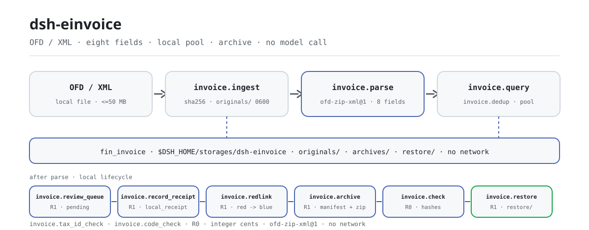

<div align="center">

<picture>
  <source media="(prefers-color-scheme: dark)" srcset="docs/assets/dsh-einvoice-flow-dark.svg">
  
</picture>

# dsh-einvoice

**Transforme notas fiscais eletrônicas locais em um registro consultável, deduplicado e arquivável — originais intactos e tudo sem conexão.**

Um plugin de nota fiscal eletrônica chinesa (OFD/XML) em nível de arquivo para o DeepSeek Harness: ingestão, análise, deduplicação, recibos, vínculo vermelho/azul, arquivamento e verificação, tudo na sua máquina; sem chamada à autoridade fiscal nem ao modelo.

[Instalar](#instalação-em-três-passos) · [Configuração](#configuração) · [FAQ](#faq) · [简体中文](README.md) · [English](README.en.md) · [Español](README.es.md) · [Português](README.pt.md) · [हिन्दी](README.hi.md)

[](LICENSE)
[](#compatibilidade)
[](https://www.npmjs.com/package/dsh-einvoice)
[](https://github.com/PerryLink/dsh-einvoice/actions/workflows/ci.yml)
[](#compatibilidade)

[](https://github.com/PerryLink/dsh-einvoice/stargazers)
[](https://www.npmjs.com/package/dsh-einvoice)
[](https://dshfind.com/plugins/PerryLink/dsh-einvoice?ref=badge)
[](https://dsh.market/)
[](https://gitee.com/perrylink/dsh-einvoice)

```sh
dsh plugin --profile <profile> add dsh-einvoice
```

</div>

<sub>Plugin da comunidade, sem afiliação com a DeepSeek. Repositório canônico: <https://github.com/PerryLink/dsh-einvoice> (o Gitee é um espelho). Status: alpha · verificado apenas com dados públicos/sintéticos · não GA — sem dados ou evidência de clientes, sem promessa de produção.</sub>

## O que é

Leia uma nota fiscal eletrônica local `.ofd` / `.xml`, calcule o SHA-256, guarde o original e extraia os oito campos (número da nota, data de emissão, comprador e vendedor, valor, imposto e total), as linhas, a evidência de campos e os campos desconhecidos; depois agregue tudo num registro local que você pode consultar, deduplicar e arquivar por entidade e período. O dinheiro é conciliado em centavos inteiros, reingerir os mesmos bytes é idempotente e o número da nota é único dentro de uma entidade. Tudo roda na sua máquina — sem rede, sem chamada a modelo, sem upload, e o arquivo original nunca é modificado.

- **Indicado para**: autoconferências antes de reembolsar dezenas a algumas centenas de notas fiscais eletrônicas; detectar a mesma nota apresentada por duas entidades; agrupar notas por período, registrar recibos, vincular notas vermelhas/azuis e manter um pacote de arquivo verificável.
- **Não indicado para**: verificação na autoridade fiscal ou dedução de IVA (este pacote é **offline** e não chama nenhuma API fiscal); notas escaneadas ou fotografadas (sem OCR); notas em PDF.

## Instalação em três passos

1. **Instalar** (escolha um canal):

   ```sh
   # canal npm (recomendado; versões publicadas)
   dsh plugin --profile <profile> add dsh-einvoice
   # canal git (main mais recente; equivalente a git+https://github.com/PerryLink/dsh-einvoice.git)
   dsh plugin --profile <profile> add github:PerryLink/dsh-einvoice
   # canal tarball: pnpm pack neste repo, depois
   dsh plugin --profile <profile> add ./dsh-einvoice-<version>.tgz
   ```

2. **Configuração mínima**: não há chaves de configuração próprias do plugin — o `cordis.patch.yml` apenas `insert` uma linha e os padrões funcionam. Só as variáveis de ambiente podem precisar de ajuste (ver «Configuração»).

   ```yaml
   - insert:
       - id: dsh-einvoice
         name: dsh-einvoice
   ```

3. **Verificar que monta**:

   ```sh
   dsh --profile <profile> --dump-config | grep dsh-einvoice
   node samples/quickstart/run.mjs
   ```

   O quickstart usa as duas notas sintéticas incluídas (uma XML e uma OFD de nota digital) e chama em ordem `invoice.ingest → invoice.parse → invoice.dedup → invoice.query`. Deve terminar com:

   ```text
   ok: quickstart finished (6 tool calls, 1 duplicate invoice found)
   ```

   Dentro de uma sessão, basta pedir — é uma tradução do prompt de demonstração incluído no `package.json` como `dsh.demo.prompt`:

   > Apresentei a mesma nota fiscal eletrônica em duas entidades (invoice-a.xml e invoice-a-copy.ofd). Ingeste e analise as duas, deduplique e me diga o número da nota e o total.

**Desinstalar**: `dsh plugin --profile <profile> remove dsh-einvoice` (ou remova a linha do patch do perfil).

<details>
<summary>Instalar pela loja do DSH Desktop</summary>

Todos os plugins da PerryLink estão na loja embutida do DSH Desktop: **Market → Sources → Add source → cole** `https://perrylink-dsh-catalog.perrylink.workers.dev/catalog-source.json` **→ selecione**. A instalação ainda exige a verificação de identidade npm da loja e a sua confirmação.

</details>

## Capacidades principais

- **Ingestão em nível de arquivo** — `invoice.ingest` lê um OFD/XML local dentro das raízes de entrada permitidas, calcula o SHA-256 e guarda o original em `originals/` com modo `0600`; reingerir os mesmos bytes devolve o `doc_id` existente em vez de criar outro registro.
- **Análise de oito campos** — `invoice.parse` executa o adaptador `ofd-zip-xml@1` sobre OFD antigo (`Attachs/original_invoice.xml`), OFD de nota digital (`Tags/CustomTag.xml` + `ObjectRef`) e XML independente; devolve os oito campos, as linhas, `field_evidence` (de qual nó cada campo veio) e `unknown_fields`.
- **Consulta do registro local** — `invoice.query` filtra por entidade, período, ciclo de vida ou texto com paginação estável; cada linha traz `doc_id`, número da nota, partes, valores e versão do analisador.
- **Detecção de duplicados** — `invoice.dedup` agrupa por número da nota e, na ausência dele, por CNPJ do vendedor + data de emissão + total; é somente leitura, não funde nem reescreve registros.
- **Fila de revisão manual** — `invoice.review_queue` enfileira notas analisadas para revisão local e pode marcar `entity_mismatch` / `missing_buyer_tax_id` contra um CNPJ de comprador esperado; nunca contata a autoridade fiscal.
- **Recibos locais** — `invoice.record_receipt` calcula o hash de um recibo local, adiciona um recibo imutável e avança o ciclo de vida; devolve `verification_source=local_receipt`, `tax_verified=false` e não é verificação fiscal.
- **Vínculo vermelho/azul** — `invoice.redlink` vincula uma nota vermelha negativa à sua nota azul, guardando a alocação e os deltas de valor / imposto; vinculá-la a outra nota azul gera `E_INV_REDLINK_BOUND` em vez de revincular em silêncio.
- **Arquivamento, verificação e restauração** — `invoice.archive` monta um ZIP determinístico com `manifest.json`, originais e recibos; `invoice.check` verifica hashes do manifesto, hashes dos membros, arquivos ausentes e path traversal; `invoice.restore` grava apenas quando a verificação passa.
- **Verificações de CNPJ e listas de códigos** — `invoice.tax_id_check` valida o Código Unificado de Crédito Social de 18 caracteres (GB 32100-2015, dígito verificador mod-31); `invoice.code_check` confere códigos de moeda / país / categoria de IVA (EN 16931); ambas são somente leitura.
- **Puramente local** — sem chamadas `fetch` / HTTP / DNS / WebSocket no código; sem conexão com a autoridade fiscal, plataformas de verificação de notas, ERP ou nuvem.

### Superfície de ferramentas

Os nomes das ferramentas são uma API estável (coincidem com a saída do runtime e ficam em inglês); as descrições estão localizadas. Ferramentas que escrevem são marcadas **R1 (escrita local)**, as de somente leitura **R0**.

| Ferramenta | Finalidade | Risco |
|---|---|---|
| `invoice.ingest` | Ingerir um OFD/XML local: lista branca de caminhos, ≤50 MB, SHA-256, retenção do original, idempotente por bytes | R1 escrita local |
| `invoice.parse` | Analisar OFD antigo `Attachs/original_invoice.xml` ou nota digital `Tags/CustomTag.xml`; devolver oito campos, linhas, evidência e campos desconhecidos | R0 somente leitura |
| `invoice.query` | Consultar o registro local por entidade, período, ciclo de vida ou texto com paginação estável (1–200 por página) | R0 somente leitura |
| `invoice.dedup` | Agrupar duplicados por número da nota, ou vendedor + data + total | R0 somente leitura |
| `invoice.review_queue` | Enfileirar notas analisadas para revisão manual local; marcas opcionais de CNPJ do comprador inconsistente | R1 escrita local |
| `invoice.record_receipt` | Calcular hash de um recibo local, adicioná-lo e avançar o ciclo de vida; `verification_source=local_receipt`, `tax_verified=false` | R1 escrita local |
| `invoice.redlink` | Vincular uma nota vermelha negativa à sua nota azul e guardar alocação e deltas | R1 escrita local |
| `invoice.archive` | Montar um ZIP determinístico com manifesto + originais + recibos no diretório local de arquivo e autoverificá-lo | R1 escrita local |
| `invoice.check` | Verificar hashes de manifesto/membros, arquivos ausentes e path traversal; somente leitura | R0 somente leitura |
| `invoice.restore` | Restaurar um arquivo verificado na raiz local de restauração; recusa o que não passar na verificação | R1 escrita local |
| `invoice.tax_id_check` | Validar o Código Unificado de Crédito Social de 18 caracteres (GB 32100-2015 mod-31) | R0 somente leitura |
| `invoice.code_check` | Conferir as listas de códigos de moeda / país / categoria de IVA (EN 16931) | R0 somente leitura |

`invoice.verify` e `invoice.receipt` permanecem como aliases obsoletos de `invoice.review_queue` / `invoice.record_receipt`; código novo deve usar os nomes novos.

### Entrada e saída

Entrada:

- Uma nota fiscal eletrônica local `.ofd` (nota digital `Tags/CustomTag.xml`, ou antiga `Attachs/original_invoice.xml`) ou `.xml`; UTF-8; no máximo 50 MB por arquivo; baixada do emissor ou exportada de um sistema financeiro.
- As raízes de entrada vêm de `DSH_EINVOICE_INPUT_ROOTS` (padrão: o cwd do processo anfitrião); os caminhos são resolvidos com `realpath` e escapes por link simbólico são rejeitados.
- Amostras incluídas: `samples/quickstart/input/invoice-a.xml` e `invoice-a-copy.ofd` (sintéticas: número de nota inventado e CNPJs claramente falsos `91330106TESTBUYER0` / `91310115TESTSELLER`).

Saída:

- Número da nota, data de emissão, comprador e vendedor, valor / imposto / total em centavos inteiros, linhas, evidência de campos e campos desconhecidos; grupos de duplicados e resultados de consulta.
- Originais e índice em `$DSH_HOME/storages/dsh-einvoice` (pode ser sobrescrito com `DSH_EINVOICE_HOME`); o **arquivo original nunca é modificado**; arquivos e restaurações ficam em `archives/` e `restore/`.
- Cada erro traz um código `E_INV_…`, uma mensagem simples e uma próxima ação, para você agir diretamente.

### Exemplos

Cole esta linha (traduzida do prompt de demonstração incluído no `package.json` como `dsh.demo.prompt`):

```text
Apresentei a mesma nota fiscal eletrônica em duas entidades (invoice-a.xml e invoice-a-copy.ofd). Ingeste e analise as duas, deduplique e me diga o número da nota e o total.
```

Ou rode você mesmo (execução real — a captura vem deste comando):

```sh
node samples/quickstart/run.mjs
```


*Amostras sintéticas → arquivo gabarito `samples/quickstart/expected/result.json`; o comando e os hashes de saída estão em `screenshots.json` (execução real em 2026-11-02).*

## Dados medidos

A aceitação pública/sintética é reproduzida com `scripts/acceptance.mjs`; o detalhe está em `ACCEPTANCE.csv`. Estas são as suas 10 linhas, citadas literalmente (o arquivo completo também traz `script` e `evidence_sha256`):

```csv
req_id,metric,threshold,actual,pass,source,counted
SKU-04-A01,八字段完整率（S1 合成样本）,>=0.98,1,true,public/synthetic,false
SKU-04-A02,扫描/OCR（未实现）,out_of_scope,out_of_scope,false,public/synthetic,false
SKU-04-A06,单票解析 P95（S1）,<20s,0.0027510999999999512,true,public/synthetic,false
SKU-04-A07,负样本处理率 + 字段证据覆盖（S1）,100%,1,true,public/synthetic,false
SKU-04-A08,统一社会信用代码校验位（GB 32100-2015）,1/1,1,true,public/synthetic,false
SKU-04-A09,EN 16931 代码表（币种/国家/税类）,0 issues,0,true,public/synthetic,false
SKU-04-A05,回执完整率（S2 单票）,100%,1,true,public/synthetic,false
SKU-04-A03,红蓝勾稽（S3 单对）,100%,1,true,public/synthetic,false
SKU-04-A04,归档复原（S3 单包）,100%,1,true,public/synthetic,false
PS1-QS01,quickstart 样例与金标一致,1/1,1,true,synthetic/quickstart,true
```

`SKU-04-A02` tem `pass=false` porque digitalização / OCR está explicitamente fora de escopo e não implementado — não é regressão. As demais linhas SKU são verificações de fixture pública/sintética (`counted=false`); apenas `PS1-QS01` é uma reprodução local da amostra incluída (`counted=true`). O P95 de análise de uma nota medido é ≈ `0.00275 s` (limite `<20 s`). Nada disso é uma execução de cliente e nenhuma saída é inventada.

## Configuração

Este plugin não tem chaves `Config` de Schemastery: o `cordis.patch.yml` apenas `insert` uma linha (`id: dsh-einvoice`) e os padrões funcionam. O que se ajusta são duas variáveis de ambiente e os argumentos das ferramentas.

| Variável | Padrão | Significado |
|---|---|---|
| `DSH_EINVOICE_HOME` | `$DSH_HOME/storages/dsh-einvoice` | Diretório base de originais (`originals/`), arquivos (`archives/`), restaurações (`restore/`) e do registro local; sem `DSH_HOME` cai em `storages/dsh-einvoice` sob o cwd do processo anfitrião |
| `DSH_EINVOICE_INPUT_ROOTS` | cwd do processo anfitrião | Raízes de entrada permitidas para `invoice.ingest` / `invoice.record_receipt`, separadas por `path.delimiter` (`;` no Windows) |

Os argumentos de ferramenta mais usados:

| Parâmetro | Padrão | Aplica-se a | Significado |
|---|---|---|---|
| `entity_id` | `default` (apenas `ingest`) | `invoice.ingest` / `query` / `review_queue` / `archive` | Id da entidade legal; o número da nota é único dentro de uma entidade |
| `page` | `50` | `invoice.query` | Tamanho da página, 1–200 |
| `profile` | `ofd-zip-xml` | `invoice.parse` | Perfil do analisador; o pacote inclui apenas `ofd-zip-xml` |
| `ocr` | `off` | `invoice.parse` | O pacote não executa OCR e aceita apenas `off` |
| `limit` | `100` | `invoice.review_queue` | Máximo de entradas na fila nesta chamada, 1–200 |
| `include_receipts` | `true` | `invoice.archive` | Se os recibos entram no pacote de arquivo |

<details>
<summary>Códigos de erro e solução de problemas</summary>

A tabela completa de códigos de erro (20 códigos, com possibilidade de nova tentativa e ação do usuário) está em [`docs/configuration.md`](docs/configuration.md); os passos sintoma / causa / ação estão em [`TROUBLESHOOTING.md`](TROUBLESHOOTING.md). Os mais comuns:

| Código | Quando aparece | Próximo passo |
|---|---|---|
| `E_INV_FILE_UNREADABLE` | Caminho inexistente, 0 byte ou mais de 50 MB | Confirme que o caminho está sob uma raiz de entrada, ou comece pela amostra incluída |
| `E_INV_PATH_NOT_ALLOWED` | O arquivo está fora de `DSH_EINVOICE_INPUT_ROOTS` | Mova o arquivo para uma raiz de entrada ou amplie a variável |
| `E_INV_DOC_NOT_FOUND` | O `doc_id` nunca foi ingerido | Rode `invoice.ingest` primeiro |
| `E_INV_DUP_CONFLICT` | O número da nota já existe sob o mesmo `entity_id` | Use `invoice.query`, ou escolha outro `entity_id` |
| `E_INV_OFD_UNSUPPORTED` | O ZIP não é um OFD ou não há XML de nota reconhecível | Use o `.ofd` original do emissor; PDF / imagens não são suportados |
| `E_INV_XML_SCHEMA_DRIFT` | Total ≠ valor + imposto, ou a estrutura mudou | Use `field_evidence` para localizar o nó; confirme que a nota não foi reeditada |

</details>

## FAQ

<details>
<summary>Onde os dados ficam? Meus arquivos originais são tocados?</summary>

Os originais são guardados por hash de conteúdo em `$DSH_HOME/storages/dsh-einvoice/originals/` (modo `0600`), o índice fica no domínio de armazenamento local `fin_invoice`, os pacotes de arquivo vão para `archives/` e as restaurações para `restore/`. Os arquivos de entrada são somente leitura — as ferramentas nunca os reescrevem e não há caminho de upload.

</details>

<details>
<summary>Ele processa minhas notas reais? Verifica na autoridade fiscal?</summary>

Analisa notas eletrônicas OFD/XML padrão localmente, mas o pacote é alpha e verificado apenas com dados públicos/sintéticos — não constitui conclusão de auditoria, reembolso ou pagamento. Anonimize dados reais antes de usar e mantenha um revisor humano. **Sem verificação fiscal**: `invoice.record_receipt` apenas registra um recibo local (`verification_source=local_receipt`, `tax_verified=false`) e nunca se conecta à autoridade fiscal nem a uma plataforma de verificação de notas.

</details>

<details>
<summary>Por que analisar a mesma nota duas vezes gera `E_INV_DUP_CONFLICT`?</summary>

O número da nota é único dentro de um `entity_id`; isso protege o registro contra ingestão duplicada e não é falha de análise. Use `invoice.query` para inspecionar o registro existente; se a mesma nota realmente foi apresentada por duas entidades, analise-a com outro `entity_id` — é exatamente o que a amostra incluída demonstra.

</details>

<details>
<summary>Os campos analisados não batem — o que fazer?</summary>

Comece por `field_evidence` (de qual nó XML ou `ObjectRef` cada campo veio) e `unknown_fields` (presentes na nota mas não usados por este pacote); a conferência monetária apenas exige total = valor + imposto. `invoice.ingest` precisa rodar antes de `invoice.parse`; uma deriva estrutural gera `E_INV_XML_SCHEMA_DRIFT` em vez de adivinhar em silêncio.

</details>

<details>
<summary>Não instala / não monta — o que fazer?</summary>

Confira `node --version` para `>=24.9 <25` e `dsh --version` para `>=0.2.1-rc.3 <0.4.0`; depois confirme a montagem com `dsh --profile <profile> --dump-config | grep dsh-einvoice`. Os passos completos estão em [`TROUBLESHOOTING.md`](TROUBLESHOOTING.md).

</details>

## Limites de segurança

- **Sem rede, sem chamada a modelo.** O código não contém chamadas `fetch` / HTTP / DNS / WebSocket; os metadados de demonstração do `package.json` também declaram `network: false`. Entrada e saída permanecem locais.
- **Os arquivos originais nunca são modificados.** As escritas caem apenas sob `$DSH_EINVOICE_HOME` (padrão `$DSH_HOME/storages/dsh-einvoice`) em `originals/`, `archives/`, `restore/` e no domínio de armazenamento local; os originais são gravados com modo `0600`.
- **Lista branca de caminhos de entrada.** Os caminhos são resolvidos com `realpath` e precisam ficar sob `DSH_EINVOICE_INPUT_ROOTS`; escapes por link simbólico, arquivos vazios, não regulares e maiores que 50 MB são rejeitados.
- **Descompactação OFD limitada.** No máximo 1000 entradas e 100 MB descompactados; o processamento de entidades XML está desativado, bloqueando bombas ZIP e expansão de entidades.
- **Guardas de adulteração e path traversal no arquivo.** `invoice.check` verifica hashes do manifesto, hashes dos membros, arquivos ausentes e path traversal; `pkg_id` precisa corresponder a `^pkg_[0-9a-f]{16}$`, o destino de restauração precisa ficar sob a raiz de restauração, e `invoice.restore` recusa um pacote que não passe na verificação.
- **Proteção contra duplicados.** Reingerir os mesmos bytes é idempotente por `source_sha256`; o número da nota é único dentro de um `entity_id`; revincular uma nota vermelha a outra nota azul é rejeitado (`E_INV_REDLINK_BOUND`).
- **Erros uniformes, falhas em voz alta.** As falhas trazem um código `E_INV_…`, uma mensagem simples e um próximo passo; uma entrada não suportada falha em voz alta em vez de degradar em silêncio.
- **Sem superfície oculta.** Sem ferramentas R2/R3, sem exposição MCP, sem metade cliente; o anfitrião monta apenas os serviços `tools` e `storageDomain`.

## Permissões e dados

- **Lê**: as notas eletrônicas `.ofd` / `.xml` e os arquivos de recibo que você indicar (precisam estar sob uma raiz de entrada); nenhum outro diretório.
- **Escreve**: `$DSH_HOME/storages/dsh-einvoice` (originais, índice, arquivos, restaurações); originais intactos.
- **Rede**: não (sem chamadas HTTP / DNS / WebSocket no código).
- **Sistemas externos**: nenhum (sem autoridade fiscal, plataforma de verificação de notas nem ERP; sem uploads).
- **Fronteira de dados**: verificado apenas com amostras públicas/sintéticas; sem dados ou evidência de clientes.

## Limitações conhecidas

- **Verificado apenas com dados públicos/sintéticos.** Cada linha de aceitação vem de uma fixture pública ou sintética (linhas SKU com `counted=false` em `ACCEPTANCE.csv`; PS1-QS01 é uma reprodução local da amostra com `counted=true`); sem dados ou evidência de clientes.
- **Alpha / parcial / não contabilizado / não GA.** Sem promessa de produção; não constitui conclusão de auditoria, reembolso ou pagamento.
- **Sem OCR.** Notas escaneadas, fotografadas e PDF não são suportadas; `invoice.parse` aceita apenas `ocr: off`.
- **Sem verificação fiscal.** Um recibo é apenas um registro local (`tax_verified=false`); para dedução de IVA ou conferências fiscais, use os canais oficiais.
- **Ingestão de um único arquivo.** Um OFD/XML por chamada, no máximo 50 MB; para lotes, itere `invoice.ingest`.
- **Apenas CNY e um analisador.** A moeda é fixa em `CNY` e os valores são em centavos inteiros; o único analisador é `ofd-zip-xml` (versão `ofd-zip-xml@1`), e um perfil desconhecido gera `E_INV_UNKNOWN_IMPL`.
- **O armazenamento é JSON KV.** O domínio `fin_invoice` não tem chaves estrangeiras, transações entre tabelas nem migrações; a unicidade de `(entity_id, invoice_no)` é checada no código da aplicação.
- **Sem interface de cliente.** O pacote é somente host e não registra slot nem pacote cliente; tudo passa pela superfície de ferramentas.
- **Limites exatos.** Os limites por ferramenta são exatamente a tabela de «Capacidades principais» mais o `ACCEPTANCE.csv`.

## Interoperabilidade com outros plugins DSH

- **Nomes de ferramenta com namespace.** Todas as ferramentas ficam sob `invoice.*` e não ocupam um nome nu de ferramentas integradas ou de outro plugin.
- **Não rouba superfície do anfitrião.** Não registra comandos, slots de cliente, rotas `webServer` nem chaves de serviço; injeta apenas os serviços de anfitrião `tools` e `storageDomain`.
- **Domínio de armazenamento independente.** Usa um único domínio, `fin_invoice` (versão 1); a desmontagem é um effect do Cordis, então parar ou recarregar a quente desfaz tudo.
- **Responsabilidades complementares.** Conferências em nível de livro fiscal ficam com [`dsh-invoice-ledger`](https://github.com/PerryLink/dsh-invoice-ledger), e a conciliação de duas tabelas com [`dsh-excel-reconcile`](https://github.com/PerryLink/dsh-excel-reconcile); cada um é um pacote independente, instalado só quando necessário.

## Compatibilidade

| Superfície | Status |
|---|---|
| Harness | DeepSeek Harness `>=0.2.1-rc.3 <0.4.0` (`engines.dsh` no `package.json`) |
| Node | `>=24.9.0 <25` (`.nvmrc`: 24) |
| Plataformas | Onde o DSH rodar; apenas arquivos locais |
| Dados | Sem rede, sem chamada a modelo, sem upload |

## Ecossistema e qualidade

- [Espelho no Gitee](https://gitee.com/perrylink/dsh-einvoice) (espelho sincronizado; o GitHub é o canônico)
- [Página do plugin no dshfind](https://dshfind.com/plugins/PerryLink/dsh-einvoice) (instalações e ranking)
- [DSH Market](https://dsh.market/) (listado)
- **Canal da loja 1024**: `npm i -g dsh1024` uma vez, depois `dsh1024 plugin --profile <profile> add dsh-einvoice` (conta no ranking de instalações da [deepseek1024.com](https://deepseek1024.com))
- Documentação: [`TROUBLESHOOTING.md`](TROUBLESHOOTING.md) · [`PRIVACY.md`](PRIVACY.md) · [`SECURITY.md`](SECURITY.md) · [`docs/architecture.md`](docs/architecture.md) · [`docs/configuration.md`](docs/configuration.md)
- Índices: [Índice de domínio](https://perrylink.github.io/dsh-plugins/) · [Família de checkers](https://perrylink.github.io/zh/checkers/) · [Artigo de cenário](https://perrylink.github.io/dsh-plugins/articles/finops-suite.html)

### Trabalho relacionado e checkers

Pacotes irmãos e índices da família: [dsh-bankrec](https://github.com/PerryLink/dsh-bankrec) · [dsh-ap-three-way](https://github.com/PerryLink/dsh-ap-three-way) · [dsh-travel-recon](https://github.com/PerryLink/dsh-travel-recon) · [dsh-finops-suite](https://github.com/PerryLink/dsh-finops-suite)

Cada checker é um pacote independente com seu próprio pacote de regras e versão; instale apenas os que você precisa:

| Pacote | Por que é relevante |
|---|---|
| [`dsh-invoice-ledger`](https://github.com/PerryLink/dsh-invoice-ledger) | Conferências de duplicados, aritmética, partes e datas em nível de livro de notas; complementa a análise em nível de arquivo deste pacote |
| [`dsh-excel-reconcile`](https://github.com/PerryLink/dsh-excel-reconcile) | Conciliação genérica de duas tabelas quando o registro de notas precisa ser alinhado a um livro externo |

## Desenvolvimento

```sh
pnpm install --frozen-lockfile
pnpm build && pnpm lint && pnpm typecheck && pnpm test   # build tsc + node --test test/*.test.mjs (11 arquivos de teste)
pnpm gate:sku04                                         # portão de aceitação (ACCEPTANCE.csv)
node scripts/acceptance.mjs                             # repetir a aceitação pública/sintética
node samples/quickstart/run.mjs                         # amostra sintética; espera 6 chamadas de ferramenta e 1 grupo duplicado
```

O código TypeScript está em `src/` (`src/core/` para os oito campos e o dinheiro, `src/adapters/` para OFD/XML, `src/registry/` para o registro de analisadores, `src/plugin/` para a face de anfitrião); a compilação vai para `lib/`; as fixtures estão em `fixtures/` e a amostra incluída em `samples/quickstart/`. Versão atual `0.2.1` (confere com `package.json`). Os testes rodam com `node --test test/*.test.mjs`; skips por amostras públicas ausentes são normais, não falhas (ver [`TROUBLESHOOTING.md`](TROUBLESHOOTING.md)). O diagrama de cabeçalho é gerado programaticamente por [`scripts/gen-readme-assets.py`](scripts/gen-readme-assets.py) (Python; saída `docs/assets/dsh-einvoice-flow-{light,dark}.svg`) e pode ser repetido.

Topics: `deepseek-harness`, `dsh`, `dsh-plugin`, `einvoice`, `invoice`, `ofd`, `perrylink`, `finance`

## Família e agradecimentos

Este projeto faz parte da família de plugins do DeepSeek Harness da [PerryLink](https://github.com/PerryLink) (todos Apache-2.0). Se for útil, **uma estrela ajuda a próxima pessoa a encontrá-lo** — nada fica bloqueado atrás dela.

- [@PerryLink](https://github.com/PerryLink) — criador e mantenedor: o analisador OFD/XML, a normalização de oito campos, o registro de notas e a deduplicação, os recibos / vínculo vermelho-azul / verificação de arquivos, a amostra quickstart e a suíte de aceitação, e a documentação em cinco idiomas.

## Licença

[LICENSE](LICENSE) (Apache License 2.0) © 2026 dsh-einvoice contributors; veja também `NOTICE` e `THIRD-PARTY-NOTICES`.

<p align="center"><sub>Apache-2.0 · Plugin da comunidade, sem afiliação com a DeepSeek.</sub></p>
